# 客户端界面与工作站更新 · 2026-11-15

Minecraft **26.3** / Java **26**，显示版本 **0.1.2**。Fabric、Forge、NeoForge 共用 HTML/CSS、Java 交互桥和 GPU 转场。进入世界前使用动态星环背景；游戏内仍从透明区域透出场景，局部深色底板保证明亮场景中的可读性。

本轮移除菜单搜索框、搜索按钮、快捷入口与文字过滤；原生搜索输入不再投影或接收隐藏输入。分类、分页、配方浏览及必要的名称、地址、聊天、书写输入保留。各页面的 `BOUND BY LIFE` 装饰页脚已删除。

## HUD 编辑与操作

2026-11-15 后续修复了选择页三维法球的黑色矩形背景。离屏纹理使用显式透明清屏；三模组各通过 10 组 GPU 回归，既检查原始 Alpha，也检查最终画面是否保留底色，并确认旋转动画继续更新。命令：`python scripts/test-magic-sigil.py fabric`，平台也可替换为 `forge` 或 `neoforge`。

在世界中按 **F8**，或从暂停菜单进入 **HUD 布局编辑**。F8 可以在原生按键设置中修改。左侧选择快捷栏、魔法、武器、生命与饥饿、状态、通知、聊天、首领条、状态效果或倒计时，然后拖动对应框；滚轮或加减按钮单独调整大小，方向键微调，Shift＋方向键加快移动。选择未出现的组件时会显示淡色占位框。保存／Enter 写入 `config/teamlifebind-hud-layout.properties`；取消／Esc 恢复本次编辑前的状态。可以单独重置或全部重置。布局采用屏幕比例位置，缩小窗口时限制在可视区域内，放大窗口后恢复所设缩放。

快捷栏保持九格居中，名称和经验文字独立布局。学会魔法后，左下魔力及三个冷却槽持续显示，持枪时也保留；魔法书用于学习，施放不再要求手持魔典。模组默认 V 施放、按住 G 选择并松开确认，也支持点击、数字键 1～3、左右方向键及改键。选择本身不施法、不消耗魔力。选择页右上角使用独立 GPU 渲染的三维法球、交错星环和学派颜色，离开页面停止绘制，关闭动效时冻结旋转。

Paper 使用 F 切换、潜行＋F 施放，未学魔法时 F 保持普通副手交换。由于原版客户端不会向 Paper 发送自定义按键，Paper 以玩家的“交换副手物品”绑定为准。

## 菜单与浮层

合成界面的配方图鉴只有一个开关；分类是横向标签，配方使用小格，筛选和翻页独立。材料、产物及背包仍执行原始容器协议。大厅页头增加局部高对比底板，同时保留游戏内透明画布及原有流体转场。

F3＋F4 使用紧凑四卡布局，F4 按原生顺序循环，松开 F3 后由服务器确认模式。聊天打开时预填光标位于末尾；手动移到中间编辑仍保留，命令历史及补全同步原生输入位置。

赛制设置先通过独立选择页选模式：SUR 显示模式入口，PVE 增加闯关难度，RG 增加难度与团队重生次数，PVP 显示胜负规则、据点、收圈及相应重生设置；隐藏选项的配置保留。通知每次显示一条并排队，在默认布局中避让状态面板、首领条及聊天。开局倒计时读取服务器提供的剩余秒数，显示数字和进度；取消或停止信号后自动隐藏。自定义 HUD 位置以玩家的编辑结果为准。

针对这些操作的实机回归命令：`python scripts/test-archive-e2e.py --platform fabric --interaction-only`，将平台替换为 `forge` 或 `neoforge` 可运行其他端。所有世界、配置和截图都位于隔离的 `.tools` 目录；服务器逻辑另通过 `scripts/test-magic-teststop.py` 与 `scripts/test-play-modes-paper.py` 检查。

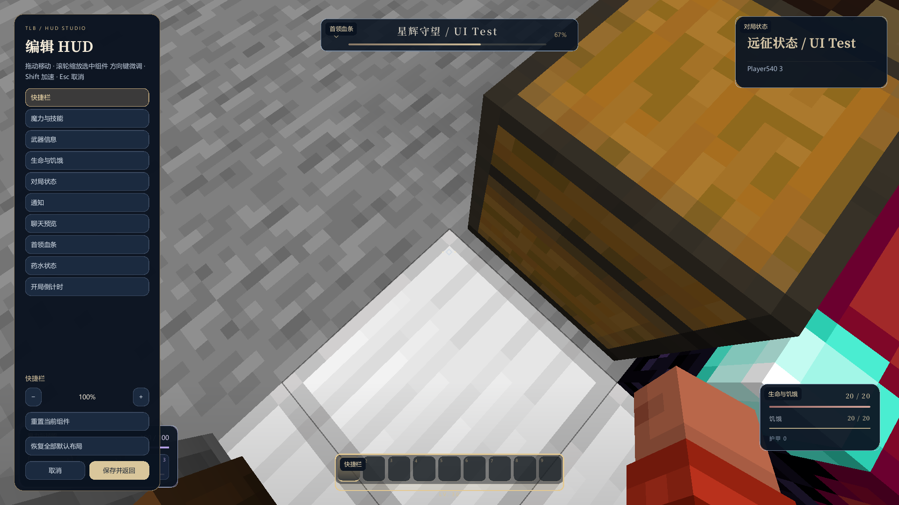

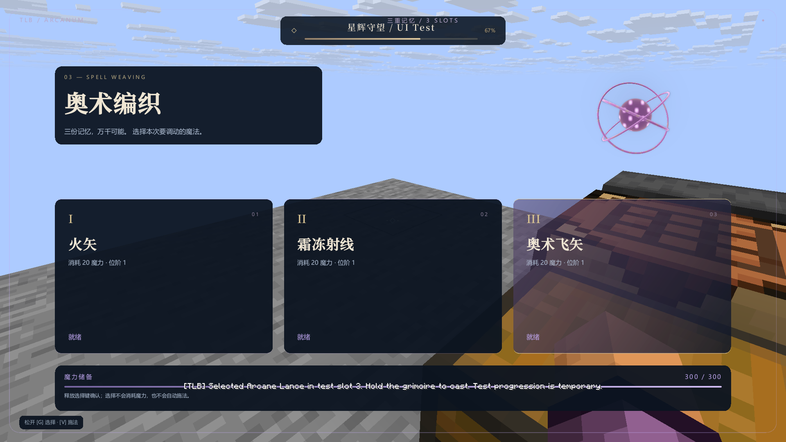

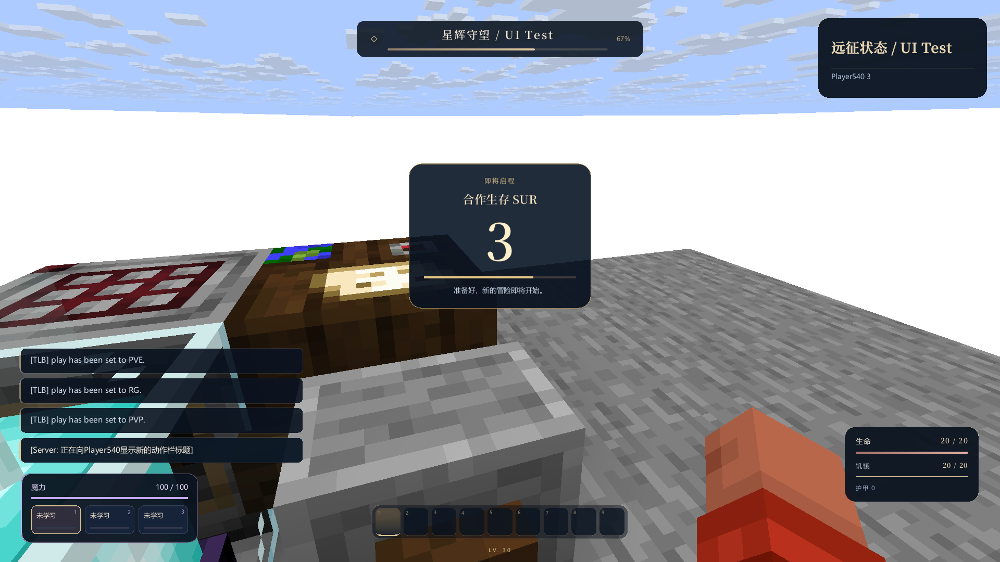

本批回归包含三模组的真实按键与服务器确认、每端 18 组项目菜单场景，以及 Fabric 完整容器操作、合成产物、熔炉／酿造进度、重载与关闭转场。Iris 实测关闭／开启／再次关闭，魔法持续可见且正确受墙体遮挡。独立服务端检查通过 Native 魔法 156 项、Native 玩法 1236 项、Paper 365 项断言；HUD 与浮层另覆盖 1920×1080、1152×720、720×480、576×384 四种布局。

## HUD 聊天可读性

左下角最近消息使用半透明深色圆角卡片，12px 字号、1.65 倍行高和独立内边距；最新消息提高对比度。底板覆盖完整文本，不再向右渐隐到难以辨认。

浮层按实际排版高度保留能完整放入的最近消息。超出的旧消息整条移出；单条过长时只缩短 HUD 预览并显示省略号，不删除或修改原生聊天记录。使用当前绑定的聊天键可以查看全文。缩放窗口、字库就绪和资源重载都会重新计算，支持中文、连续英文、换行及 Unicode 字符。

消息默认靠近左下快捷栏；出现武器／魔法面板时，按它的实际位置向上避让。对局状态移至右侧，小高度窗口收紧状态标题与行高，避免覆盖消息。浮层不接收鼠标，不影响移动、瞄准和原生聊天输入。

离线回归 `python scripts/test-archive-usability.py` 覆盖 1920×1080、1152×720、720×480、576×384 和五种消息类型，共 20 组聊天布局。最后一档用于覆盖系统／界面缩放后的实际 CSS 视口。`python scripts/test-archive-e2e.py --platform fabric --chat-only` 在真实客户端检查字体、消息边界、状态栏避让、缩放、资源重载和完整聊天历史，另输出 `chat-*.png`；先还原最大化窗口，并检查窗口真正改变尺寸。去掉 `--chat-only` 会额外执行完整容器协议检查。

[常规窗口实机](images/archive-chat-preview.png) · [720×480 长消息预览](images/archive-chat-preview-small.png)

2026-11-14 本批验收：Fabric、Forge、NeoForge 及 Fabric + Sodium 0.9.2 / Iris 1.11.7 共四次真实客户端检查通过，20 张聊天截图确认实际窗口尺寸；字体重载、完整历史和关闭操作正常。Iris 组合额外通过光影关闭 → 开启 → 关闭与实体墙遮挡检查。独立测试目录运行，不读取用户存档。

## 布局与操作

主菜单将标题、单人游戏和多人游戏放在左侧，Realms 使用更紧凑的入口。右侧星轨随动效设置播放或冻结，语言、辅助功能、选项、退出和加载器附加入口在底部。窗口较矮时会缩小标题和按钮，并按可用高度收起补充说明。可用 `python scripts/test-archive-ui.py --title-only` 在三个加载器上检查主菜单布局和 GPU 转场。

暂停页使用双列操作，突出返回游戏，并将保存退出固定在底部。确认页将内容与确认、取消按钮分开。

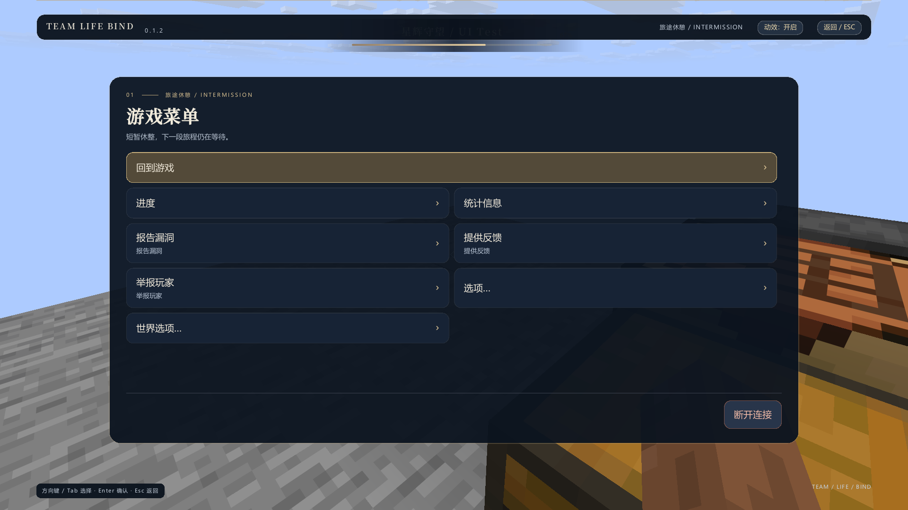

设置首页按原生身份分类。视频、在线、声音、鼠标、改键、辅助功能、聊天与皮肤页读取实际子控件及当前值：26.3 的 `OptionsList.Entry.children()` 不能被误当成一个无名称条目。滑块按可见轨道定位，支持方向键，“完成”固定在滚动区外。

滑块现在有可见的拖动圆点和较大的轨道点击区；圆点、填充和文字一起读取原生值。鼠标与键盘焦点分别显示，键盘导航跳过不可用项，主菜单底部入口也能获得键盘焦点。跨页波纹进行时拦截鼠标点击与滚轮，避免点中尚未显示的新页面；Esc 仍立即交给原生控制器。

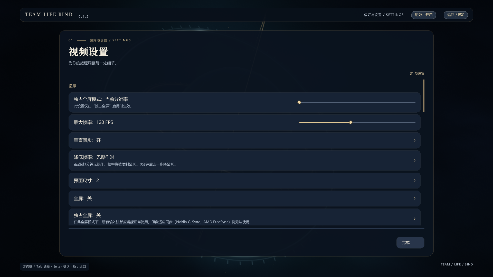

创建世界使用游戏／世界／更多三个真正的标签页，名称和种子仍由原控制器校验，创建／取消固定在底部。标签指示线按实际按钮边界平滑移动。

标签点击会经过原生 `TabNavigationBar`，由它切换当前页并刷新页面布局；仅调用 `TabButton.mouseClicked` 不会完成切换。回归检查通过窗口鼠标事件依次点击“世界 → 更多 → 游戏”，确认原生选中项、HTML 指示状态和改过的世界名称／种子均保留。

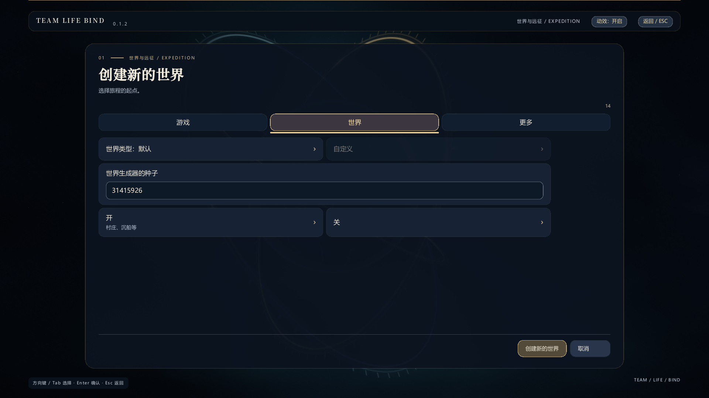

世界与服务器采用独立列表：单击选择，双击或 Enter 进入；异步发现、状态更新、删除和实验性世界确认继续使用原生命周期。语言页显示原生名称与地区并按实际条目计数。好友页面、入口、对应选项和改键条目保持移除。

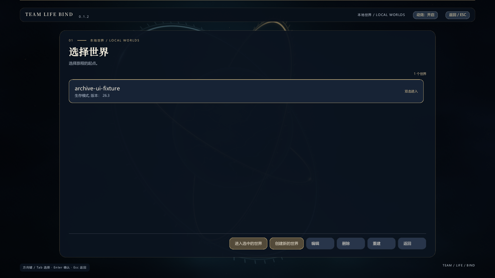

## 工作站与物品

工作区与行囊使用有边界的两栏布局，长说明不会再将背包挤出画面；小窗口内各区独立滚动。输入映射回原槽位，原 `Slot`、配方、回调与服务端确认保持有效。

行囊主区固定为 **9 列 × 3 行**，快捷栏单独放在下方，**1～9 从左到右保持一整排**，通过分隔线和不同底色区分。窗口缩小时统一缩小槽位和图标，不把快捷栏折行。箱子、工作站及随身背包共用这一排布，装备／副手仍在装备区。

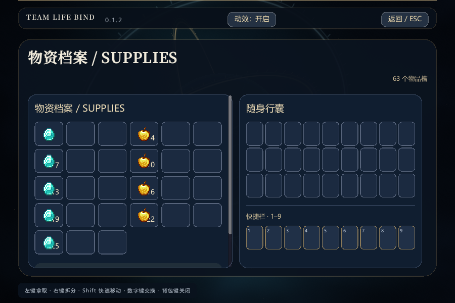

| 界面 | 用途与状态 |
| --- | --- |
| 箱子、木桶、末影箱、潜影盒、漏斗、发射器 | 容器与行囊分区，图标数量、悬停详情、Shift 转移与拆分 |
| 随身背包 | 角色预览，头盔／胸甲／护腿／靴子／副手标记，2×2 合成与结果 |
| 工作台 | 保留配方位置的 3×3 材料、绿色成品区、具名配方图鉴 |
| 熔炉、烟熏炉、高炉 | 原料、燃料、成品；真实烧炼进度与燃料余量 |
| 酿造台 | 三个瓶位、试剂、烈焰粉；真实进度、剩余秒数与燃料 |
| 铁砧 | 装备、修复材料、成品、原生重命名和等级消耗 |
| 锻造台 | 模板、装备、升级材料、成品 |
| 砂轮 | 装备、可选同类装备、成品和祛魔说明 |
| 制图台 | 地图、纸／空地图／玻璃板、成品与用途 |
| 切石机、织布机、附魔台、交易 | 明确材料角色及原生配方／图案／附魔／交易选择 |
| 信标 | 矿物祭品、原生效果选择与真实基座层数 |
| 合成器 | 3×3 配方、禁用槽标记、只读预览与红石输出说明 |
| 讲台 | 正文、翻页、书籍和原生取书动作 |
| 马、鹦鹉螺等坐骑 | 鞍具、护甲和可用行囊，沿用原槽位限制 |

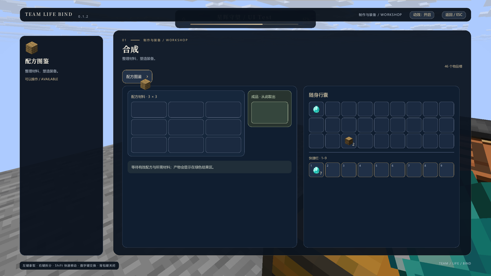

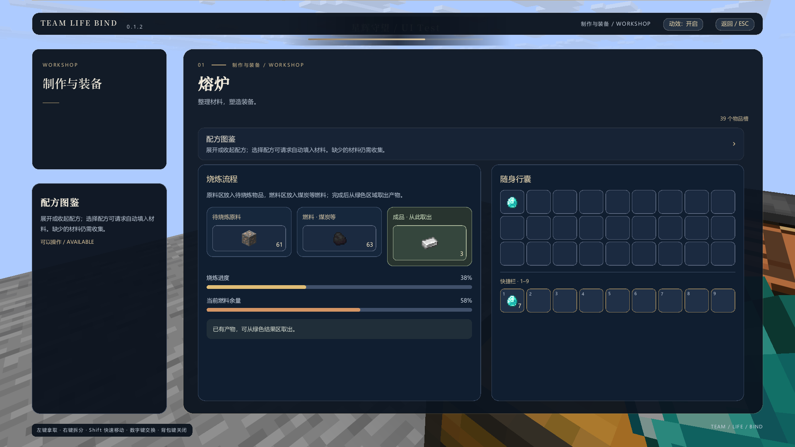

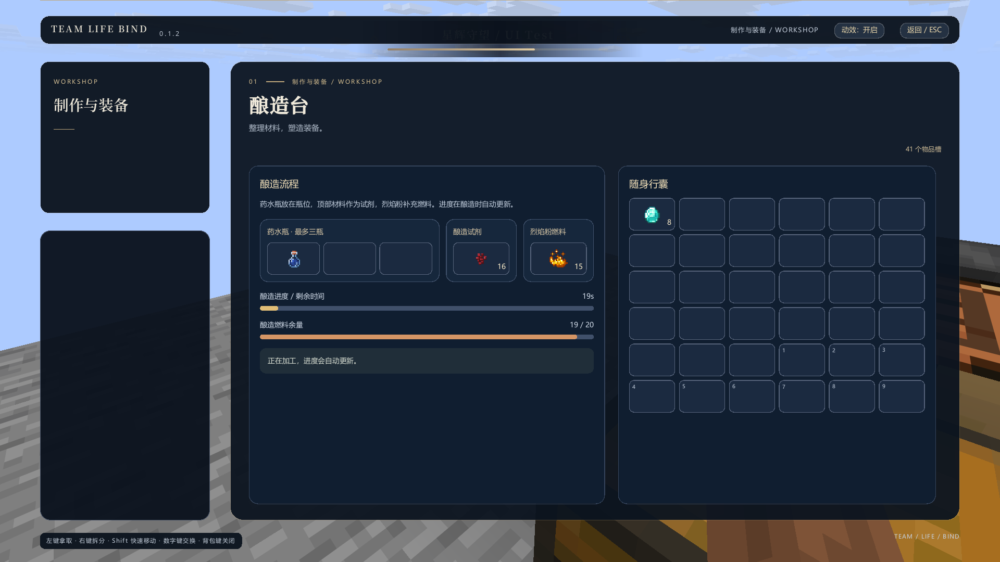

烧炼进度取自 `AbstractFurnaceMenu`，酿造使用实际当前及总时长。即时合成不制作虚假耗时进度。等待材料、加工中和已有产物分别提示，只读预览不伪装成可取出的物品。

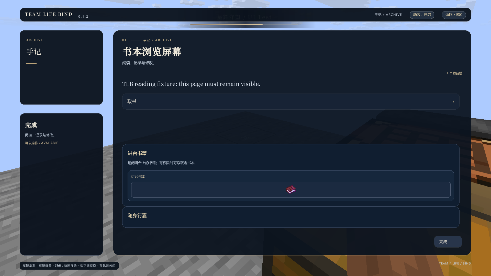

六类大厅、赛制、开发物品、魔法目录、RG 路线与远征菜单保留分类、分页、键盘选择、完整详情和服务端校验，见 [AUI 菜单指南](aui-web-ui.md)。

## 字体、HUD 与退场

首次加载覆盖层早于原生字库发布。首批资源成功完成前只绘制 GPU 加载效果和实际进度条，字库可用后再出现文字。HTML 页面另有就绪检查，样式和全部字体发布后才进入 PIP 绘制。

资源重载会重建文档树；标准窗口、HUD、魔法选择、叠层与装饰页头按文档代次重新绑定，避免继续使用旧节点。装饰文字禁止拖选，实际输入保留编辑、选取和粘贴。

魔法选择显示三张记忆卡片和真实魔力／冷却。HUD 的生命、饥饿、护甲、快捷栏、吟唱、武器状态，以及聊天、Boss、玩家列表、侧栏和通知继续读取原事件和同步数据；局部材料提高对比。

Esc、返回、关闭和页面跳转使用原来的流体波纹擦除。内容及详情切换 420ms、关闭到游戏 280ms；返回页面使用反向擦除。新页面的 CSS 和字体就绪后再计时，避免准备界面期间把波纹消耗掉。关闭、保存与物品同步立即执行，过场只处理旧／新 UI。关闭动效后直接切换。

标准界面右上角可切换动效，`Ctrl + Shift + M` 在标准界面和 TLB 专用菜单中也可切换。改键界面正在录入按键时优先保留原生录入。

## 主菜单动态背景

`ArchiveBackdrop` / `ArchiveBackdropRenderer` 和 `menu_orbit.fsh` 绘制独立的程序化场景：三个不同倾角的金银星环、带流动能量纹路的核心、雾光与星点。视差只移动背景，文字和点击区域保持稳定；设置、存档等进入世界前的页面沿用更暗的氛围。

背景着色器不读取世界纹理，进入单人或多人世界后不再提交背景绘制。装饰层上限为 **1280×720**，时间推进约 **30 帧／秒**，HTML 和文字保持完整分辨率。关闭动效或窗口失去焦点时停止时间与视差，静止图像复用已有 GPU 纹理；原波纹着色器与时序保留。

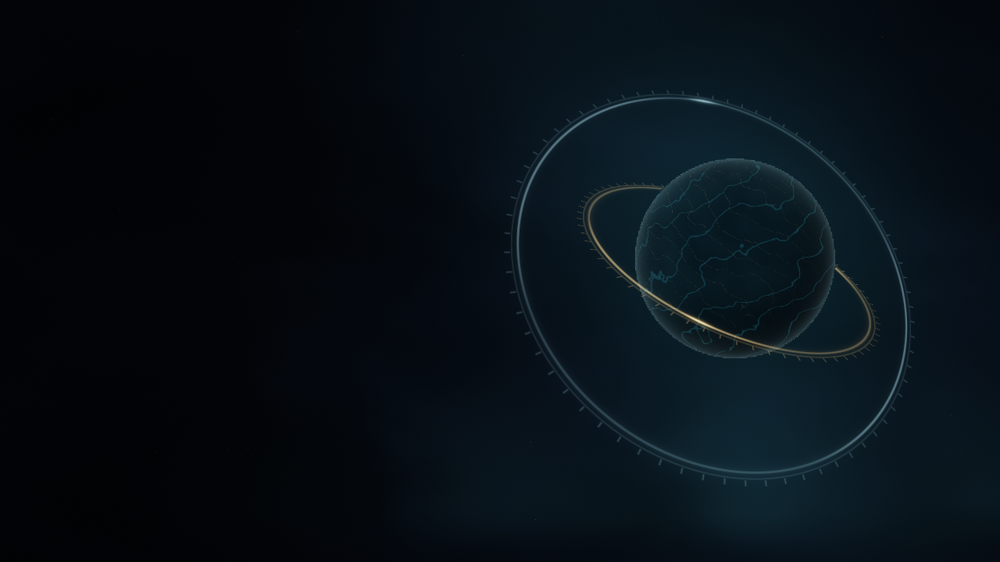

悬停时圆角描边高亮，箭头轻移。按钮位置固定，鼠标移到边缘时仍能稳定点击。实机测试覆盖三种窗口尺寸，并抓取进入设置及按 Esc 返回时的 GPU 转场中间帧。

切页前额外冻结当前 UI 的 GPU 纹理，按转场序列交给新渲染器使用；NeoForge 重建渲染器也不会丢失旧页面。缓存只包含 UI，转场结束即释放；连续操作保留当前已显示的合成结果，避免回跳。

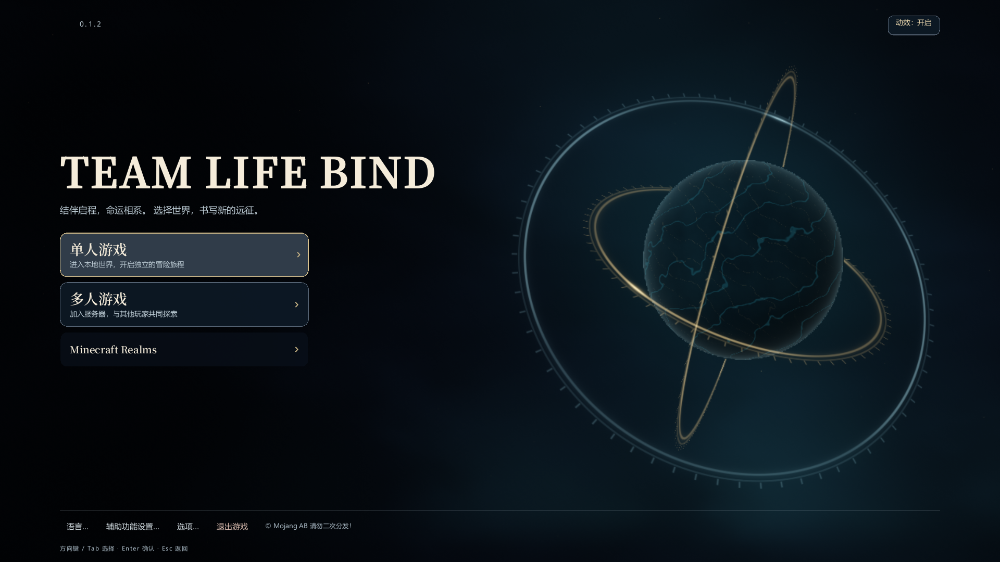

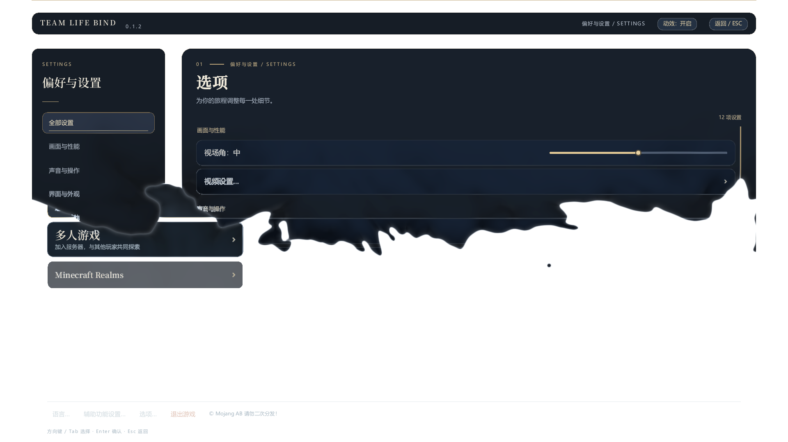

## 动效与实现

对照 Web Motion Showcase 的 60 项源码整理了 [逐项学习与适配清单](web-motion-learning.md)。本轮落地滑动标签、按压、轻抬卡片、分类下划线、真实阅读进度和滚动边界反馈。浏览器脚本没有直接搬入 AUI；文字乱序、拖尾光标和全屏背景不作为默认交互。

共享资源位于 `client-ui/src/main/resources/assets/tlb_aui/apricity/teamlifebind/`：`interface.html/css`、`navigation.css` 负责标准窗口与工作站；`menu`、`magic`、`hud`、`overlays` 负责各专用页面；`corners.css` 与 `motion.css` 共用圆角和交互样式。

`ArchiveModel` 读取原控件，`ArchiveWorkstation` 提供槽位角色及状态，`ArchivePresenter` 负责显示和坐标映射。`AuiPageReadiness` 检查样式／字体发布，`AuiScreenTransitions` 让原动作立即执行、由 GPU 负责退场。

字体包含重命名的 Noto Serif SC 与 [GNU Unifont 17.0.04](https://ftp.gnu.org/gnu/unifont/unifont-17.0.04/) 后备字库，OFL 许可、来源与哈希均内置。运行时不下载字体、网页、图片或 JS 引擎。自定义界面包需同步本轮全部 HTML/CSS 节点。

## 验证范围

`python scripts/test-archive-ui.py fabric forge neoforge`：每端 28 类 × 3 种窗口，共 **252 个实际客户端场景**。包含视频／在线等设置、创建世界三标签、文档重载、必要输入、固定操作栏、好友移除、搜索移除和原生输入单次分发。两类控件夹具共进行 **18 组滑块鼠标／方向键检查**；每端另读回 **17 帧加载着色器**。

窗口为 1920×1080／GUI 2、1440×900／GUI 2、900×600／GUI 3，系统 DPI 125%。该组不打开世界；暂停夹具包含九个原生动作，储物夹具使用真实菜单和只读库存。

`python scripts/test-aui-client.py fabric forge neoforge`：六类专用菜单 × 三种尺寸 × 三端，共 **54 个场景**。检查分类、分页入口、鼠标／键盘、详情、空列表、搜索确实移除、背包键关闭及详情／导航退场，另检查 UI 纹理转场与透明 Alpha。

`python scripts/test-archive-ui.py --motion-only fabric forge neoforge`：快速检查主菜单悬停、设置页面进入及 Esc 反向返回。每端直接读取 GPU 的六张中间帧，并断言同一帧保留新旧页面及波纹边界。测试使用 GPU 帧的序列／进度确认实际完成绘制，再通过 fence 读回透明纹理；逻辑补帧不能代替渲染帧，原生截图接口也不用于检查 UI Alpha。

`python scripts/test-archive-e2e.py --platform fabric|forge|neoforge`：在独立目录及 **127.0.0.1:25587** 测试服，从 HTML 主菜单实际进入测试存档并连接本地服务器，检查物品操作和服务器回执。每端 **22 张世界截图**，涵盖配方图鉴、工作站、实际烧炼／酿造、讲台正文、聊天回显、HUD 重载及暂停退出，共 **66 张**。实验性世界确认使用原生备份加载，备份只位于测试目录。

`python scripts/test-archive-usability.py`：离线回归真实 `OptionsList`、异步列表、条目确认、字体就绪及重载、三种尺寸的设置和长说明工作站布局，并检查 **145 种原生语言名称与地区名**的字形覆盖。

本轮另外检查真实原生标签导航事件、三种尺寸的快捷栏同排及 1～9 顺序。实际客户端创建世界检查使用窗口鼠标回调，避免直接调用 `selectTab` 掩盖 HTML 点击故障；容器检查同时核对原生槽位身份，联机测试继续验证拾取、放置、Shift 转移和拆分。

这些检查不等于穷举全部配方、账号服务和第三方模组。坐骑、交易、潜影盒等经过槽位角色审查，未将未运行的专门联机用例写成实测。Realms 账号服务不在离线联机结论内；调试与观察者入口保留原控制流程。测试不读取用户存档，不替换使用中的安装目录。安装见 [安装说明](install-0.7.0.md)。
