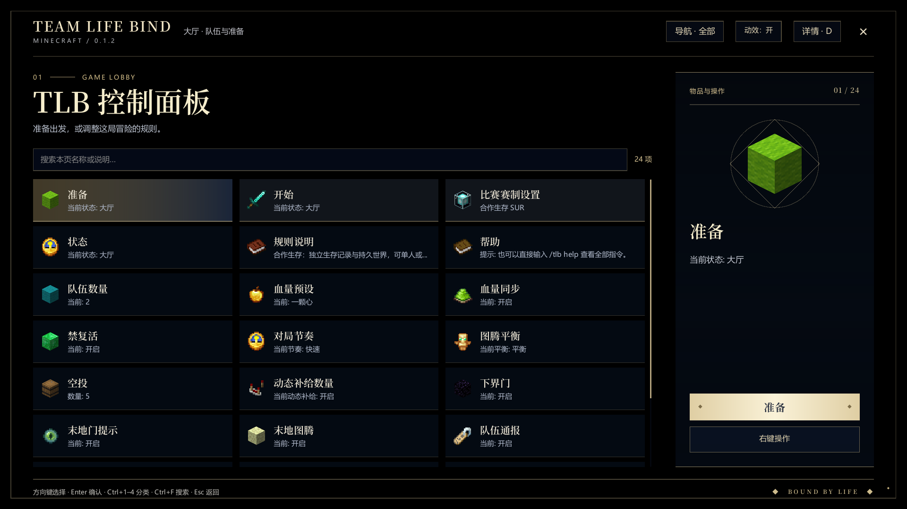
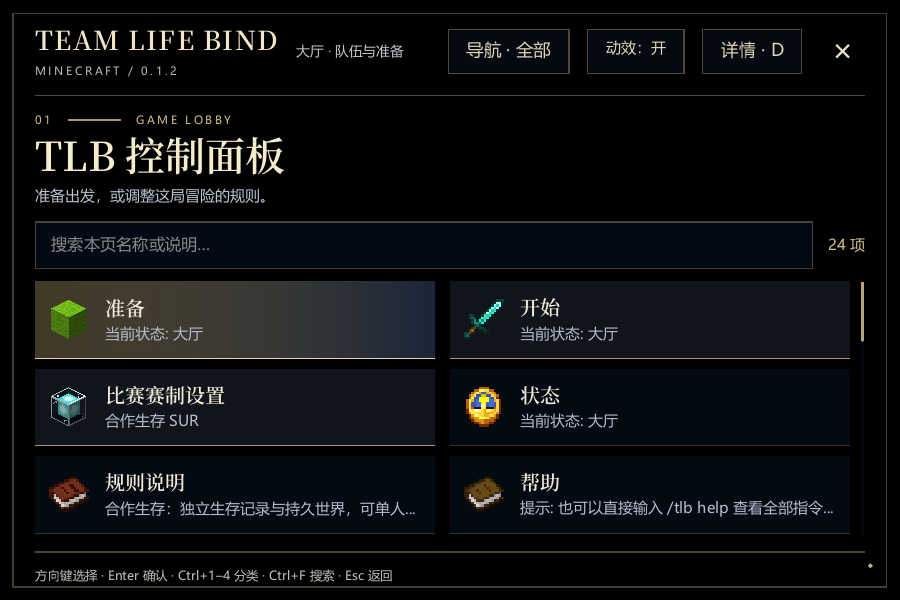
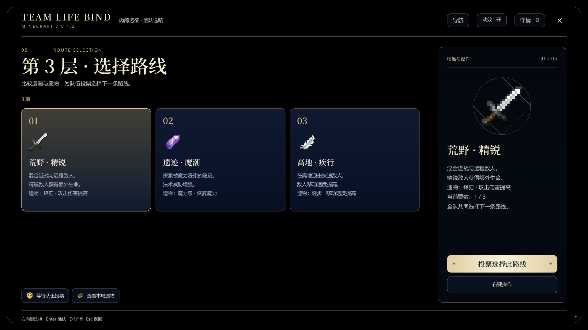
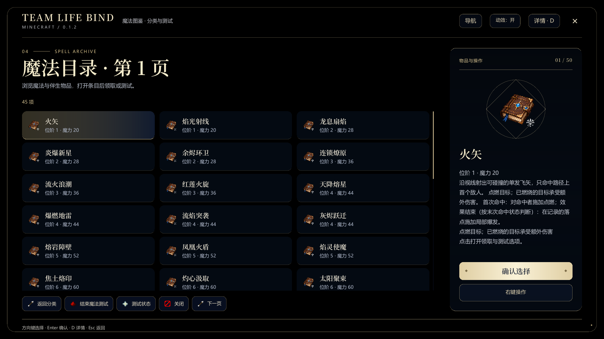
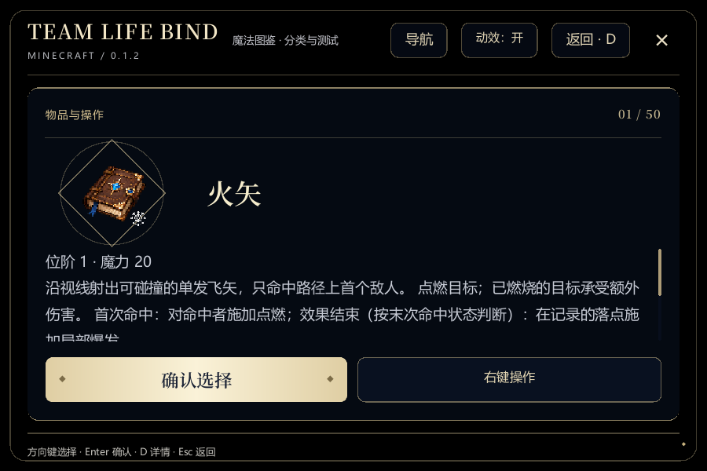

# AUI 网页菜单

2026-11-13 后续重构已将标准窗口、容器、魔法选择、HUD 与加载画面纳入共享界面，见[新布局实机预览与范围](archive-ui.md)。本页继续记录六类 TLB 专用菜单的操作。

Fabric、Forge、NeoForge 共用一套 **HTML/CSS** 菜单，运行在 Minecraft 26.3 / Java 26 上，显示版本仍为 **0.1.2**。引擎基于 [ApricityUI / AUI](https://github.com/Tower-of-Sighs/AUI/tree/be952f74299115d33af5aff74927f64570ffa569)，固定版本 1.3.0.1，并适配三种加载器的 RenderPearl 渲染与 SDL 输入。

2026-11-13 根据《白银之城》的实际代码重做交互与布局。页面底层透明，局部控件使用半透明阅读底板；标题改用内置宋体，银金刻线标识选择。菜单开合、分类切换和详情展开使用前后 UI 帧的波纹擦除。源码研究见[滚动与导航](silver-palace-scroll-study.md)及[波纹合成](silver-palace-render-study.md)。

2026-11-14 主菜单加入独立的 GPU 星环背景和左右分区布局；进入世界后的菜单继续保持透明底。顶部动效开关或 `Ctrl + Shift + M` 可切换动态／静止模式，原有波纹转场保留。滑块、焦点和转场期间的点击处理见[界面更新说明](archive-ui.md)。


[播放高清转场录像](images/aui-ink-transition.mp4)。演示由 Minecraft 实际 UI 渲染目标的 34 张逐帧读回图像编码，深色底板仅用于观看透明画面；游戏内不绘制这张底板。包含开场和分类切换，正式菜单的键盘操作即时响应。





以上为隔离的 Minecraft 客户端直接截帧，大厅内容来自实际服务端菜单的 54 槽快照，去掉装饰后保留 24 项。宽窗口使用 1920×1080／GUI 2，小窗口使用 900×600／GUI 3；测试也覆盖 1440×900／GUI 2。系统 DPI 为 125%，页面按实际 CSS 视口计算布局。





路线、赛制、开发物品与远征使用不同的代表性测试数据，魔法目录读取实际 `SpellCatalogue`；这些截图展示界面，不表示一次真实对局。实际游戏的名称、说明、票数和配置均来自服务端同步。

## 设计依据

对[《白银之城》官网](https://silverpalace.elementagames.com/zh-cn/)的实际桌面 JS、CSS 和着色器进行了拆解，并用浏览器核对悬停位移、滚轮阈值和内容显隐时序。将顶部导航、章节式标题、指针反馈与双帧擦除应用到游戏菜单。主要标题字号为 48／29px，正文为 12–15px；小窗口按内容缩排。

减少嵌套边框，图标直接使用 Minecraft 物品模型；主要操作和普通设置在大厅中区分。键盘移动即时反馈，布局重排和展开详情时，静止的鼠标不会抢走键盘选择。长说明有独立滚动区，支持鼠标滚轮和展开后的上下键。

UI 着色器采用独立实现的多尺度流动场及轮廓提取，读取旧 UI 和当前 UI 两张纹理。Alpha 始终保持透明，游戏世界和相机不参与变换。转场空闲时没有额外全屏合成；GPU 历史只在开始或打断转场时复制。

标题字体来自 Noto Serif SC，改为静态字重并保留中日韩统一表意文字、假名、标点和项目文本，重命名为 TLB Archive Serif；字体、来源记录和 OFL 许可均内置。菜单运行期间不下载图片或字体。

## 已接入的界面

| 页面 | 行为 |
| --- | --- |
| 大厅控制面板 | 全部／对局／规则／显示与帮助四类；显示真实条目数，准备、开始和赛制入口优先 |
| 赛制配置 | 从服务端同步当前设置，支持原来的左右键操作 |
| 开发者物品 | 按分页浏览并选择物品，保留领取校验 |
| 魔法目录 | 按分页浏览魔法与伴生物品，底部保留翻页、返回、结束测试和关闭等现有操作 |
| RG 路线 | 三个候选路线纵向对比遭遇、威胁和遗物；状态及构筑入口单列，票数仍由服务端决定 |
| RG 远征与遗物 | 展示进度、遗物及对应操作 |

页面不生成空白占位卡片。名称、说明和物品图标来自当前服务端菜单，文本通过 DOM 文本接口填入；物品保留实际 `ItemStack` 组件。本轮已移除搜索框、搜索按钮与快捷入口；跨页使用原菜单的翻页按钮。

## 操作与布局

- 左键或 `Enter / Space` 执行操作；右键或 `Shift + Enter` 执行替代操作。
- 方向键、`Tab / Shift + Tab` 移动选择，超出可见区域时滚动到对应卡片。上下键依据实际行位置选择，适应列数变化。
- 鼠标移到右上角 **导航** 展开目录，点击也可开合，移出后关闭。`Ctrl + M` 打开导航，方向键选择、`Enter` 确认、`Esc` 退出；同一次悬停后点击不会误关。
- 大厅用 `Ctrl + 1 / 2 / 3 / 4` 或导航中的分类切换；导航区域的滚轮可换分类，物品目录和详情区域仍处理自己的滚动。
- 宽窗口常驻侧边详情；`D` 或右上角 **详情** 展开阅读，`Esc` 先返回目录，再关闭菜单。展开后上下键滚动说明。
- 背包键关闭菜单，跟随实际改键；菜单不再接收文字搜索。
- 字号和页面尺寸按当前窗口与系统 DPI 计算，Minecraft GUI 缩放改变后仍可正确点击。
- 分类、详情及页面切换恢复原来的 420ms 流体波纹擦除，专用菜单开场 480ms，关闭到游戏画面 280ms；返回页面反向擦除，导航保留短淡出。新页面的 CSS／字体就绪后才开始计时，等待期间保留旧 UI。关闭立即交给原控制器，GPU 负责视觉退场；键盘打开详情、返回及退出同样保留波纹。
- 右上角 **动效：开／关** 控制转场；偏好保存在客户端的 `config/teamlifebind-ui.properties`。



HUD 与魔法选择随后已改用共享 HTML/CSS 页面；加载阶段使用独立 GPU 着色器，详见[后续界面重构](archive-ui.md)。

## 修改 HTML/CSS

共享源码位于 `client-ui/src/main/resources/assets/tlb_aui/apricity/teamlifebind/`：

- `menu.html`：页面结构和固定节点 ID。
- `menu.css`：颜色、字号、卡片、详情和媒体查询。
- `corners.css`、`motion.css`：共享圆角、按压与悬停反馈。

资源包可以通过相同的 `assets/tlb_aui/apricity/teamlifebind/` 路径覆盖这两个文件。重载资源包并重新打开菜单后生效。保留节点 ID，Java 桥接会重新绑定动作。AUI 的 HTML/CSS 支持范围以其[官方文档](https://doc.sighs.cc/ApricityUI/intro/)为准；它使用自己的渲染引擎，并非 Chromium。TLB 使用 Java 事件回调，因此这些菜单不需要安装 Rhino 或 KubeJS。

共享 Java 桥接位于 `client-ui/src/main/java/com/teamlifebind/clientui/`。`AuiMenuPage` 管理 DOM、分类和选择，`AuiMenuScreen` 把操作交给已打开的 `ChestMenu`。页面只发送原槽位的容器点击：领取资格、管理员权限、奖励、投票和玩法状态仍由现有服务端判断。按钮内容变化、容器被替换或页面关闭后，旧点击会被拒绝。

## 引擎与构建

`vendor/apricityui/` 保留上游原始源码和 LGPL-2.1 许可；`client-ui/aui-overrides/` 保存移植改动，`scripts/prepare-aui.py` 生成独立的 `com.teamlifebind.aui` 命名空间。无需额外安装 AUI 前置模组。三端使用同一套引擎来源，加载器只负责注册 GUI 渲染器和客户端 tick。

便携后端使用深度、裁剪矩形和纹理遮罩；旋转后的圆角溢出裁剪目前采用矩形裁剪。当前菜单没有依赖这种特殊裁剪。

Forge 的渲染器按状态类型复用，菜单和光标分别持有纹理，防止光标层在合成前清空菜单；Fabric 和 NeoForge 使用同一修复。物品图标按 CSS 尺寸缩放，详情图标不会缩成默认 16px。

构建需要 Java 26、Python 3 和 Gradle Wrapper：

```powershell
./gradlew.bat "-Pplatforms=fabric,forge,neoforge" :fabric:build :forge:build :neoforge:build
./gradlew.bat auiSourceBundle
```

发布包的 `source/TeamLifeBind-0.7.0-aui-sources.zip` 包含引擎、移植、宿主源码和构建脚本，可修改并重新构建。上游许可、固定提交和 Txtmark 的 Apache-2.0 许可也嵌入各模组 JAR。原生菜单可用启动参数 `-Dteamlifebind.ui.native=true` 调出，便于兼容性排查。

## 验证方法

```powershell
python scripts/test-aui-client.py fabric forge neoforge
python scripts/test-client-ui.py
```

第一项启动隔离测试客户端，不打开存档。六类菜单分别在宽、中、小窗口中检查目录及展开详情的真实绘制、键盘、右键、搜索移除、空列表和关闭后的文档释放，截图与证据保存在 `.tools/aui-client-evidence/`。大厅快照位于 `scripts/fixtures/aui-lobby.json`，自测通过启动参数读取，正式菜单不加载它。第二项使用真实 Minecraft 菜单类核对原槽位、左右键、只读预测和过期点击。

波纹额外从实际 UI 渲染目标读回保留 Alpha 的数据，逐帧检查开场透明、旧内容保留、前后内容空间混合和局部区域外稳定性，并验证打断后从已显示帧继续。原版截图会强制不透明，不能用来判定 UI 是否保留 Alpha。

2026-11-13 透明交互批次验证：

- Fabric、Forge、NeoForge 各 **18 个真实客户端场景**通过，共 **54 个场景、108 张原始截图**。每类菜单均检查三个窗口尺寸的目录与展开详情，覆盖中文文字、真实物品模型、左右键及背包改键关闭。
- 三端各通过实际 GPU 波纹检查，每端额外保留 **37 张带 Alpha 的读回图像**。检查开场零覆盖、完整界面的透明区域、前后帧端点、空间擦除与银色轮廓、局部区域之外像素不变，以及打断时的连续性。
- 新增悬停展开／移出关闭／同次点击不误关、导航快捷键、大厅分类、搜索与快捷入口移除、魔法固定导航、长说明滚动、静止鼠标与键盘选择、连续上下键穿越滚动目录等检查。每次截图前等待实际 AUI 样式与渲染帧完成。
- 三端菜单桥接和原生兼容菜单各 **338 项断言**通过，包含真实大厅数据、原槽位编号、只读预测、容器替换和过期按钮拒绝。
- 资源检查覆盖三端相同的 **405 个模组语言键**。发布构建运行共享模块检查及四端构建，并检查发行包内的页面、着色器、字体、类、许可与对应源码。
- 运行记录同时保存源码与截图 SHA-256；三端页面共用相同的 HTML/CSS。NeoForge 的独立菜单类探针仍使用 vanilla API 夹具，完整 FML 绘制由前述真实客户端测试覆盖。

2026-11-12 引擎接入时，三个隔离独立服务端还完成了启动、SUR／RG 指令检查及正常退出。本次重写只涉及客户端菜单及验证材料。测试均使用隔离目录，没有打开玩家存档或连接外部服务器。
