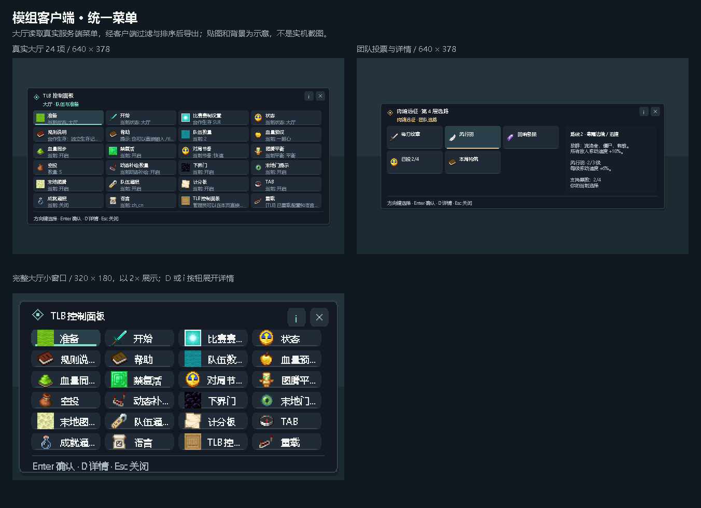

# 模组界面更新 · 2026-11-02

2026-11-13 后续批次已更新为共享 HTML/CSS 布局，见[当前实机预览与覆盖范围](archive-ui.md)。本页保留此前布局与数据模型的记录。

**2026-11-12 更新**：大厅、赛制、开发物品、魔法目录和两个 RG 菜单现已采用 AUI HTML/CSS，当前操作、实机截图及样式修改请看 [AUI 网页菜单](aui-web-ui.md)。本文保留此前原生界面的布局与验证记录；HUD、魔法轮盘仍适用，原生菜单也可通过兼容开关使用。

Fabric、Forge、NeoForge 共用新的深色面板、薄荷青／暖金强调色和清晰的选中状态。游戏显示版本 **0.1.2**，构建编号 **0.7.0**，运行环境仍为 **Minecraft 26.3 / Java 26**。

同日布局修复：旧大厅用灰玻璃占位，上一版误将这些非空物品识别为按钮。现在排除没有名称、说明或动作的灰玻璃装饰；截图对应的管理员大厅从 **41 张卡片收紧为 24 项有效内容**。准备、开始、赛制和状态优先排列，设置值直接显示在卡片内。大厅和赛制菜单通过 `D` 查看完整说明，不再常驻右侧详情栏。

大厅数据由真实隔离服务端生成，经生产客户端的过滤与排序后交给 `NativeUi` 导出，包含全部 24 项内容。RG 为示例内容，物品贴图与背景均为示意，**不是 Minecraft 实机截图**。

## 更新范围

| 界面 | 本次变化 |
| --- | --- |
| 大厅 | 排除玻璃装饰，常用操作优先；卡片直接显示当前值，按需展开长说明 |
| 赛制设置 | 使用完整面板宽度，设置值随卡片显示，保留原有设置及权限判断 |
| 开发者物品目录 | 使用可选择的物品卡片，领取仍由服务端检查权限和背包容量 |
| 魔法分类、列表及详情 | 按物品数量调整密度；继续使用原有分页、分类和测试按钮，长说明可滚动 |
| RG 路线投票 | 三条路线优先并列展示，票数、状态和详细机制来自服务端 |
| RG 远征／遗物面板 | 相同的详情栏和滚动阅读方式，保留返回路线与关闭操作 |
| 魔法／枪械 HUD、对局侧栏 | 更醒目的魔力和弹量数字、三槽选中底色、分段进度及一致的底板 |
| 魔法轮盘 | 中央魔力环、槽位连线和学派色卡片；选中法术名独立显示 |

菜单展示有效内容，过滤空槽及明确的空白灰玻璃装饰。有名称、说明或动作的玻璃物品仍保留。初始选择指向第一个有效按钮；视觉排列会变，但点击发送原来的槽位编号，因此分页、右键操作、权限、发奖和投票判定仍由原有服务端逻辑处理。普通箱子与其他模组的容器继续使用各自界面。

## 操作

- 左键确认；有替代操作的按钮继续支持右键。
- 方向键或 `Tab / Shift + Tab` 移动选择，`Enter / Space` 确认。
- `D` 或右上角 **i** 展开完整说明；滚轮、`Page Up / Page Down` 阅读长内容。
- 展开说明时 `Esc` 返回卡片，其他时候 `Esc`、背包键或右上角 **×** 关闭菜单。
- 魔法、轮盘、切槽和换弹继续读取原来的可修改键位；默认 `V / G / Alt + 滚轮 / R`。

宽 GUI 的物品、魔法和 RG 菜单提供右侧详情栏；大厅／赛制菜单及窄窗口通过悬停提示和展开详情阅读。稀疏菜单使用宽卡片，密集目录根据可用空间增加列数。截图对应的 `640×378` GUI 中，大厅由 11 行收紧为 6 行，面板高度由 336 降至 264。常见最小 `320×180` GUI 坐标下，完整 54 槽也能落在面板内。菜单图标不会被客户端箱子预测拿到光标上，拖动和中键不会移动或复制图标。

## 安装

从发行包选择对应加载器的模组，**同时替换模组服务端和玩家客户端 JAR**。单人存档／本地开房只需替换自己的模组文件并重启。新菜单依赖服务端在标题中携带界面标记；旧服务端不会主动开启新面板，旧客户端收到新标题时仍可显示原箱式菜单。无需另装材质包或光影，完整步骤见[安装说明](install-0.7.0.md)。

本批次 Paper 插件及资源包保持上一 RG 批次的内容；新的客户端 UI 类与翻译不会打进 Paper 发行物。已安装上一版新界面的用户，此次布局修复只需替换对应客户端 JAR；其服务端菜单协议保持兼容。

## 验证范围

- 三模组和 Paper 编译成功；公共规则回归 **1,430,685** 项断言。
- 生产 HUD 布局导出通过 **2,729** 个矩形、**107** 次文本绘制、**915** 对文本重叠和 **20** 项原版战斗区域避让检查；菜单布局通过 **1,920** 项边界与槽位映射检查，覆盖五种 GUI 尺寸。
- `scripts/test-client-ui.py` 使用实际生产屏幕、Minecraft 菜单和 SDL 输入值，三端各通过 **309** 项断言：左右键编号、原始槽位、键盘导航、说明展开、滚动、拖动及只读预测，并重放完整的真实大厅数据，检查装饰过滤、24 项按钮、初始焦点及四种尺寸的逐卡点击。有名称或说明的灰玻璃也有保留回归。Fabric／Forge 使用实际平台 MC 类；NeoForge 使用 vanilla 26.3 API 运行夹具，不代表完整 FML 客户端启动。
- 官方 Mixin 转换器在三个平台的实际 `MenuScreens` 类上验证了新注入点、取消逻辑和原始容器创建分支，共 **27** 项检查。
- Fabric 隔离真实服务端的 SUR/PVE/RG/PVP 回归及大厅数据采集通过 **1,075** 项断言，测试世界和配置已恢复。Forge、NeoForge 已在同日界面批次验证隔离服务端启动、模式指令及退出；本次布局修复未修改服务端生产逻辑。
- 资源检查覆盖 **367** 个模组翻译键、**705** 个共享翻译键及现有模型／着色器资源。

准备本地测试夹具后，先运行 `python scripts/test-play-modes.py` 采集真实大厅，再运行 `python scripts/test-client-ui.py` 重放输入，最后用 `python scripts/render-client-ui.py` 生成布局预览。上述验证没有启动图形客户端；资源包字体、实际 GUI 缩放与多人战斗中的最终观感仍需实机确认。HUD 的显示条件与键位细节见[HUD 说明](native-hud.md)。
