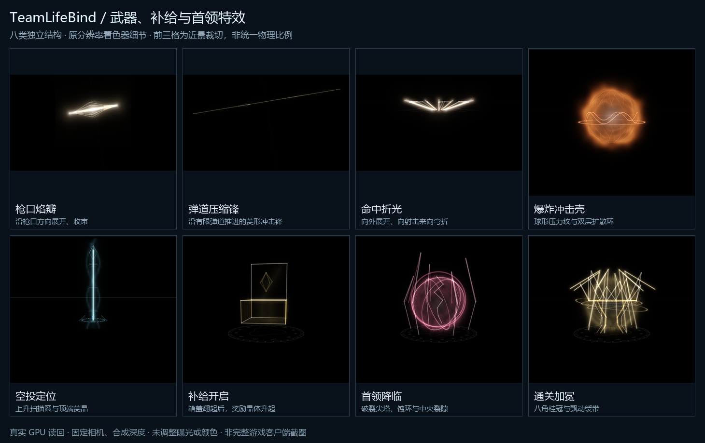
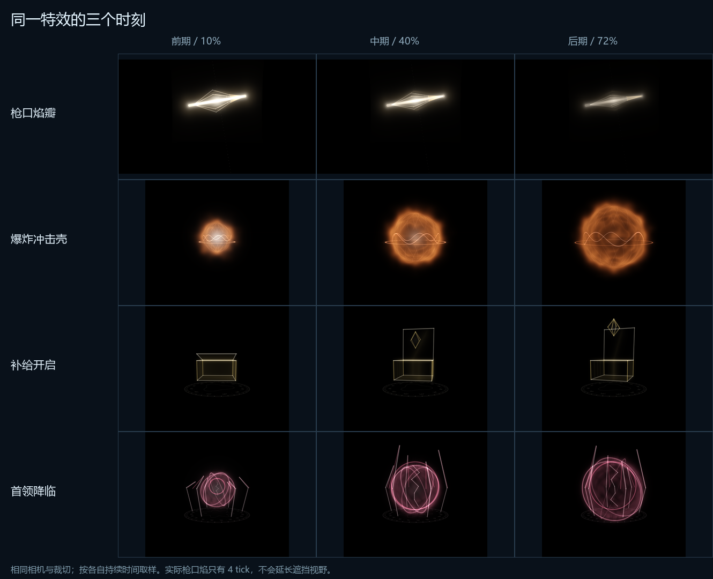

# 武器、补给与首领特效 — 2026-11-05

Fabric、Forge、NeoForge 为八类既有世界事件补充独立的动态结构。显示版本仍为 **0.1.2**，构建编号 **0.7.0**，Minecraft **26.3**，Java **26**。



前三格放大裁切了较小的枪械效果，不代表八类特效具有相同的物理尺寸。图中像素来自生产渲染管线，没有调整曝光、颜色或补画效果。

## 更新内容

| 事件 | 新增视觉 | 实际触发 |
| --- | --- | --- |
| 枪口 | 五瓣立体焰纹与收束热环，沿枪口朝向展开 | 枪械实际开火 |
| 弹道 | 沿有限线段推进的菱形压缩锋与细环 | 子弹／火箭弹道同步 |
| 命中 | 七组弯折碎光，向射击来向抬起，随后衰减 | 命中实体或方块 |
| 爆炸 | 向外扩散的球面压力纹、裂纹与双层冲击环 | 火箭实际爆炸 |
| 空投定位 | 地面支撑纹、上升扫描圈、顶部双锥菱晶 | 尚未领取的空投信标刷新 |
| 空投开启 | 半透明箱体、翻开的铰链箱盖、延后升起的奖励晶体 | 开启引导成功并生成补给 |
| 首领降临 | 六组破裂尖塔、竖立蚀环和中央锯齿裂隙 | PVE／RG 首领成功生成 |
| 通关 | 八角升起的桂冠和摆动绶带 | 闯关完成，参战玩家结算 |

补给开启的旧通用光柱已改为箱体表面，方便辨认开盖过程。枪口仍只持续 4 tick，弹道 5 tick；效果寿命、射击判定、伤害和奖励规则沿用此前实现。以上使用连续几何、解析曲面和体积能量，不创建 Minecraft 粒子。



## 渲染与验证

新增细节在已有原分辨率着色器层绘制，薄线使用导数抗锯齿；箱体表面进入已有体积层。读取世界深度，墙后效果被遮挡，爆炸内部可以看到远侧冲击壳。沿用同屏数量、体积像素和细节覆盖预算。

- 三端各 **342 项**专项 GPU 检查：八类新细节对比禁用新结构的控制画面；去掉旧结构、体积与颜色后的 **28 组**轮廓比较；**24 帧**生命周期取样；九种真实尺寸射击朝向；100／192 格弹道端点；爆炸内部、部分遮挡、过期和重载。
- 三端各 **530 项**世界效果检查：全部 **24 类**事件、持续标记、深度、清理及跟随。18 帧随身／固定位置比较与参考画面逐像素一致。
- 三端各 **3,517 项**魔法攻击回归，覆盖 **300 种法术、347 个机制阶段、694 组吟唱／攻击组合**。
- Fabric 另用 **2560×1440** 帧缓冲执行同一专项检查。发行 JAR 内的渲染类和五个着色器哈希与测试记录绑定。

这些检查使用 Minecraft 26.3 的 RenderPearl 和真实 GPU，以固定相机及合成深度渲染。预览不是完整游戏客户端截图；未将它作为多人帧率或外部光影兼容的实机结论。

## 安装

已安装上一批[成长与远征特效](journey-vfx.md)的用户，只需替换**玩家客户端对应加载器 JAR 并重启**。单人／本地开房替换自己的模组即可；更早批次请同时更新模组服务端，以获得此前新增的世界事件。

不需要额外光影包。Paper 插件与资源包保持上一批文件，枪械仍只在模组端。文件名和显示版本沿用，请以本批 ZIP／SHA-256 区分。

复查命令：

```text
python scripts/test-magic-renderpearl.py --built-renderer --combat-details --output .tools/vfx-combat-final-details
python scripts/test-magic-renderpearl.py --built-renderer --world-effects --output .tools/vfx-combat-final-world
python scripts/test-magic-renderpearl.py --built-renderer --attack-stages --output .tools/vfx-combat-final-attack
python scripts/test-magic-renderpearl.py --built-renderer --combat-details --platform fabric --width 2560 --height 1440 --output .tools/vfx-combat-final-1440p
python scripts/render-combat-vfx-preview.py
```
