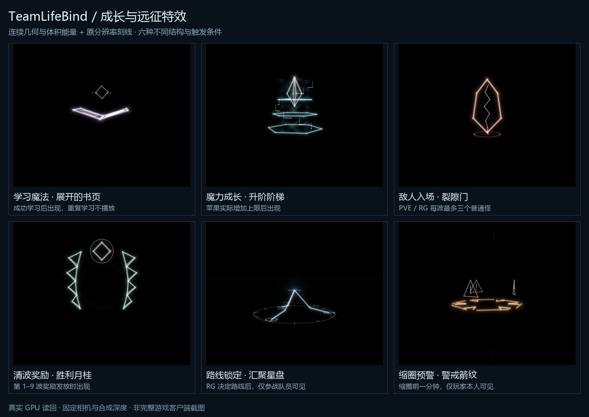

# 成长与远征特效

本批为 Fabric、Forge、NeoForge 增加六类玩法着色器效果，世界事件共 **24 类**。显示版本保持 **0.1.2**，Minecraft **26.3**，使用 **Java 26**。

| 场景 | 表现 | 实际触发 |
| --- | --- | --- |
| 学习魔法 | 展开的双页、书写刻线、上浮知识印记 | 法术书成功学习并消耗后 |
| 魔力苹果 | 三层六边环、上升阶梯、悬浮晶核 | 苹果实际增加魔力上限后 |
| 敌人入场 | 张开并收束的角形裂隙、内部连续裂光 | PVE／RG 普通敌人成功加入世界后，每波最多三次 |
| 清波奖励 | 上浮月桂和菱形完成印记 | PVE／RG 第 1–9 波奖励实际发放时 |
| 路线锁定 | 三路汇聚星盘、中心节点、内收指示环 | RG 团队投票产生决定并授予遗物后 |
| 缩圈预警 | 低位警戒箭纹、三角感叹符号 | 开启缩圈规则后，开局第 24 分钟提醒一分钟后开始缩圈 |



魔力回复药水仍使用回蓝效果，苹果成长采用独立结构。已学会的书、上限已满的苹果、重复投票和重复奖励处理不会播放成功演出。清完第十波继续使用既有的通关特效；首领入场也保持原有演出。裂隙只表现敌人出现，不改变碰撞或产生额外敌人。

路线星盘出现在本局中心，只发给附近、同维度的有效参战队员。缩圈预警只发给玩家本人；其箭纹是提醒，不表示世界边界的位置或安全范围。学习、成长、清波和预警使用逐帧玩家插值，入场裂隙与路线星盘保持固定世界落点。

## 渲染与同步

采用原有 HDR 体积通道与原分辨率刻线通道，全部由连续几何绘制，无新增粒子发射器。书页有表面发光，魔力成长带螺旋能量，裂隙有内部亮面，细节层负责文字横线、阶梯、裂光、叶脉和星盘刻度。

沿用每维度每 tick 96 个视觉事件上限、魔法／世界各 24 个缓存、每帧 8／4／2 个效果上限，以及体积层 1,382,400 像素和细节层两个屏幕的覆盖预算。敌人入场额外限制每波最多三个普通怪；丢失怪物的补生也不能绕过此上限。渲染预算不改变敌人数量、学习、物品或奖励结果。

新事件使用可选 `teamlifebind:world_vfx_v3` 通道。只有旧 `world_vfx`／`world_vfx_v2` 通道的客户端不会收到这些负载，避免解码未知类型。魔法攻击同步格式不变。

## 验证

- 三端分别通过 **530 项**生产 GPU 检查：全部 24 类世界事件的可见性、动画、深度遮挡、过期，持续标记刷新，长弹道及资源重载。
- 六种新增细节统一为白色并移除体积层后进行 15 组轮廓比较；原分辨率细节均有独立的画面贡献。六种新效果另做 18 组移动对齐检查，随身／固定落点与参考读回无像素差。
- Fabric 隔离服务端通过 **1,234 项**实际控制器、命令、物品与原生实体断言，包含 SUR／PVE／PVP／RG、新触发、失败操作、重复操作、接收范围和旧通道过滤。测试存档与配置恢复为运行前内容。
- 全部 300 种法术及超位连段的 347 个机制阶段、694 组吟唱／攻击组合，三端各 **3,517 项**检查通过；Forge、NeoForge 独立服务端启动与玩法命令检查通过。生产类和五个着色器的哈希与发行文件核对。

预览来自生产 RenderPearl 管线的真实 GPU 读回，使用固定相机、合成深度及相同裁切，没有调整亮度、颜色或补画效果。它不是完整游戏客户端截图；多人帧时间、实际游戏背景与外部光影兼容尚未实机验收。

## 安装

本批请同时替换**客户端和模组服务端**对应加载器的 JAR；单人／本地开房替换自己的模组并重启即可。无需额外光影包。文件名与显示版本沿用，请用本批 ZIP／SHA-256 区分批次。

Paper 插件与资源包保持上一批文件。上一轮的 [20 类攻击结构和高阶演出](magic-delivery-vfx.md)、[14 学派刻纹和队伍特效](vfx-plus.md)继续保留。

复查命令：

```text
python scripts/test-magic-renderpearl.py --built-renderer --world-effects
python scripts/test-magic-renderpearl.py --built-renderer --attack-stages
python scripts/test-play-modes.py --log-name vfx-journey.log
python scripts/render-journey-vfx-preview.py
```
