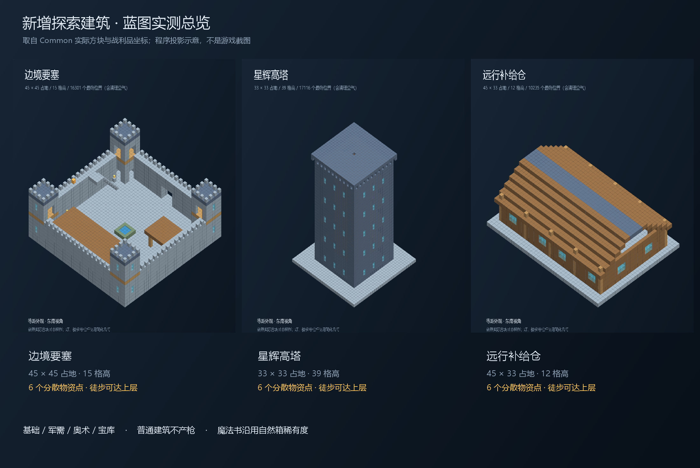

# 大型建筑与 Paper 枪械移除

2026-10-20，显示版本 **0.1.2**，内部构建 **0.7.0**，Minecraft **26.3 / Java 26**。

四个平台加入三种自然生成的大型建筑。Paper / Bukkit / Spigot 插件版移除枪械；Fabric、Forge、NeoForge 的七枪与空投限定规则继续保留。

## 建筑与物资

上图由实际生成蓝图导出，为结构投影与物资示意图，不是游戏截图。单体图片还提供楼层平面图：

| 建筑 | 尺寸（宽×高×深） | 布局 | 物资点 |
| --- | --- | --- | ---: |
| [边境要塞](images/landmark-fortress.png) | 45×15×45 | 四角塔楼、城墙步道、营房、中庭与水井 | 6 |
| [星辉高塔](images/landmark-tower.png) | 33×39×33 | 多层楼梯、环形窗带、悬灯与高层宝藏 | 6 |
| [远行补给仓](images/landmark-depot.png) | 45×12×33 | 双翼仓房、装卸入口、货架与阁楼 | 6 |

18 个物资点分散在室内、城墙和上层区域，均有可步行或跳上一格台阶的抵达路线。建筑使用原版方块，不需要额外建筑材质包。

| 物资级别 | 主要内容 |
| --- | --- |
| 基础 | 面包、火把、皮革或铁粒 |
| 军需 | 铁锭、箭、熟牛肉、盾或弩 |
| 奥术 | 青金石、紫水晶、魔力药水，可能有经验瓶 |
| 宝藏 | 金锭、1–2 枚钻石、高效魔力药水、金苹果，少量概率换为魔力苹果 |

每个物资点另外按已有自然箱规则抽取魔法书：**12% 出书**，阶位越高越稀有；超位绝对概率仍为每点 **0.0012%**。建筑不采用空投的高阶权重，也不生成枪械。物资随种子确定，取走后不会因开关容器、重新加载区块或重启而补货。

## 生成规则

- 每个 **512×512** 区域由世界种子确定一个候选建筑及四种朝向之一。候选位置不合适则跳过，因此不是每个区域都有建筑。
- 在主世界类世界的**新区块生成阶段**建造。普通主世界与模组每局种子比赛主世界均已接入；地狱、末地、Paper 配置的大厅世界及模组专用大厅排除。
- 生成前检查整个占地范围：拒绝水域、流体、陡坡、方块实体及非自然地面或障碍；允许小幅起伏并补齐地基。已有自然结构也可能使候选跳过。
- 旧区块不会追补建筑，已有物资不会重新填充。请探索新区块或开始使用新世界的下一局比赛。
- Paper 默认 `world-landmarks.enabled: true`；设为 `false` 并重启可停止后续建筑生成。该开关不会拆除已有建筑。

原生端沿用区块生成的邻域写入约束，Paper 使用 `LimitedRegion`；每个蓝图最多 20,000 个方块操作，最长边不超过 48 格。物品和方块状态提前解析或通过不可变缓存读取，生成线程不调用玩家魔法记录或比赛管理器。

## Paper 的变化

Paper 插件及资源包移除七枪的控制、空投生成、开发领取、模型、材质、音效及枪械说明。`/tlb dev` 基础目录现为 **12 项**，三个模组仍为 **19 项**；四端 300 本法术书和五件伴生物品的选择测试保留。

有旧枪标记的物品在登录、库存交互和打开容器等迁移入口转换成新建的普通铁马铠，移除旧自定义组件与标记；普通未标记马铠保持原行为。未访问的旧容器会在相应交互时迁移。魔法攻击末影龙的普通玩家伤害来源和归属继续保留。

Paper 总魔典仍为右键施法、F 切槽、潜行右键选择菜单，其他物品保留原版交换副手。模组枪械依旧左键开火、右键 ADS、R 换弹，支持改键；正常对局只在空投获取，无配方、无限备弹。

安装文件与资源包 SHA-1 见[安装说明](install-0.7.0.md)。

## 本轮实际验证

| 检查 | 实际范围与结果 |
| --- | --- |
| 公共回归 | 共 **1,276,599** 条断言通过，其中建筑 **1,198,944** 条；检查 12 个旋转蓝图、边界、楼梯可达性、灯具支撑、候选种子与自然掉落稀有度 |
| Paper 26.3 build 175 建筑 | 生产 JAR 的真实 `LimitedRegion` 生成通过 **48,062** 条断言；三种建筑、18 个物资点、取走后保存重载、水域/陡坡拒绝、已有容器保护及缓坡地基 |
| Paper 移除枪械 | 最终生产 JAR 通过 **2,141** 条断言；目录/说明/控制器移除、128 次空投无枪且保留魔法物资、旧枪迁移、普通副手交换与魔法末影龙伤害 |
| Fabric 原生状态解析 | **352,842** 条断言通过；12 个蓝图旋转、26 种实际方块状态 |
| Fabric 实际生成与重启 | 真实新区块生成 **398,938** 条、第二个 JVM 读取同一存档 **397,964** 条断言通过；三种建筑、18 个物资点、确定性物资、300 本书元数据、无枪与取走后不刷新 |
| Forge / NeoForge 隔离启动 | 两端均达到 `Done`，正常退出码 0；启动、Mixin 与项目错误扫描为 0 |

本地原始记录为 `.tools/landmark-release-build.log`、`.tools/paper-landmark-probe/actual-paper.log`、`.tools/paper-removal-probe/removal-2026-10-20.log`、`.tools/native-landmark-probe/probe.log` 及 `.tools/fabric-landmark-probe/{generate,reload}.log`。Forge / NeoForge 使用同构适配源码，分别构建和隔离启动；未将 Fabric 的完整新区块与重启矩阵算作这两端的实测。多人探索手感与实际客户端建筑观感仍待试玩。
