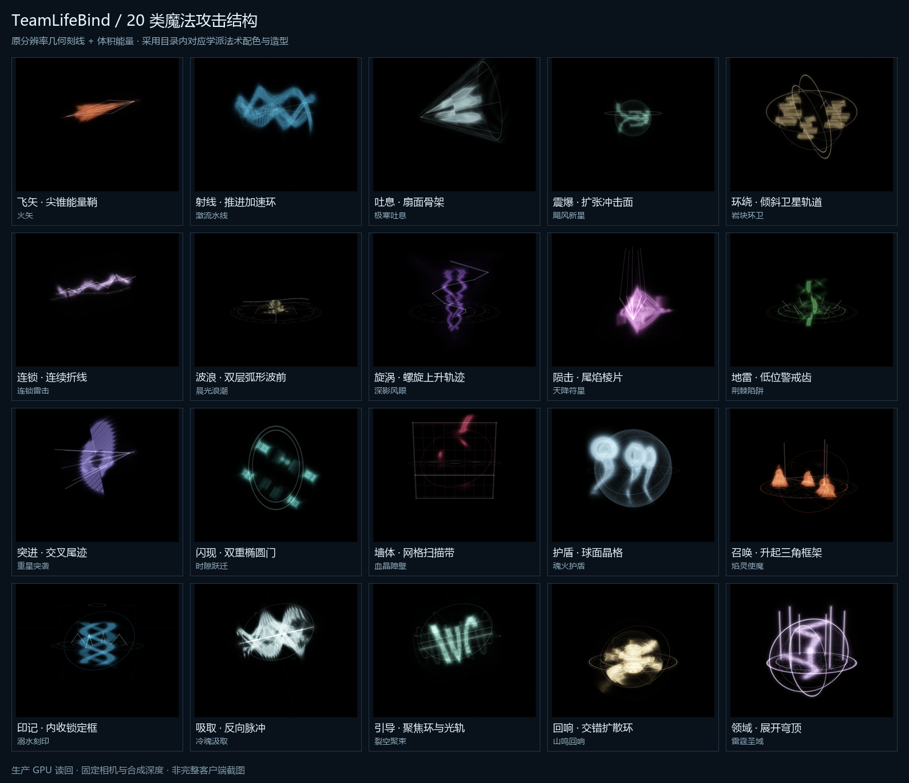
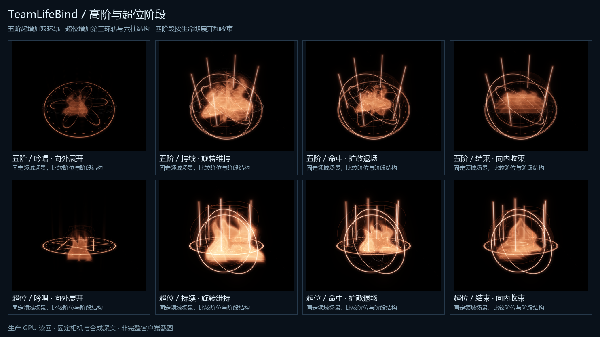

# 魔法攻击结构与高阶演出 — 2026-11-04

Fabric、Forge、NeoForge 增加 **20 类攻击阶段细节结构**，五阶以上增加多重环轨，超位增加第三环轨与六柱框架。显示版本保持 **0.1.2**，Minecraft **26.3**，使用 **Java 26**。

这批强化既有 300 种魔法的行进、持续和阶段衔接。20 类结构按法术的实际机制选择，与已有的学派刻纹、单法术视觉配置及体积能量共同绘制；它们是基础机制的视觉细节，不表示新增 300 套完全独立的几何模型。

## 新增表现

| 机制 | 画面变化 |
| --- | --- |
| 飞矢／射线 | 沿实际飞行段的尖锥能量鞘／朝目标推进的加速环 |
| 吐息／震爆 | 连续扇面骨架与出口环／向外扩张的球形冲击面 |
| 环绕／连锁 | 倾斜环轨与卫星菱形／逐段连接、随时间摆动的折线 |
| 波浪／旋涡 | 随攻击方向旋转的双层弧形波前／连续上升的螺旋轨迹 |
| 陨击／地雷 | 朝落点延伸的尾焰棱片／贴地警戒环与齿状边缘 |
| 突进／闪现 | 沿运动段展开的交叉尾迹／成对椭圆门 |
| 墙体／护盾 | 网格与向上移动的扫描带／球面晶格与流动纬线 |
| 召唤／印记 | 三角底座与升起框架／内收锁定框和悬浮标记 |
| 吸取／引导 | 从目标返回施法者的环形脉冲／固定聚焦环与转动光轨 |
| 回响／领域 | 错开时间扩散的波环／逐步展开的上半球穹顶与边界环 |



五阶起加入两组倾斜环轨；超位加入第三环轨和六组相连立柱。吟唱时由内向外展开，持续时维持旋转，命中时衰减，结束时向内收束。护盾与领域从内部观看时也绘制远侧曲面。



## 渲染与验证

新增结构写入现有的原分辨率细节通道，使用解析线段、环面交点和球面交点，不创建粒子，不增加渲染通道或网络包。与世界深度比较后再写入画面，线条使用像素导数抗锯齿。沿用体积层 1,382,400 像素、细节层两个屏幕覆盖及每帧 8／4／2 个场景的预算。高阶结构增加片元计算量，预算上限本身不代表所有显卡都有相同帧率。

- 三端分别进行 **700 项**新增 GPU 检查：20 类机制与关闭新增结构的对照、遮挡、动画、过期、内部视角、资源重载，以及五阶和超位的四阶段表现。
- 固定同一本法术并移除体积层和配色后，20 类轮廓做 **190 组**两两比较，最小轮廓差约 **37.9%**；该测试用于发现形状重复，不等同于玩家辨识率。
- 全部 300 种法术、347 个机制阶段及 694 组吟唱／攻击组合，三端各 **3,517 项**检查通过；14 学派刻纹各 **519 项**、18 类世界事件各 **251 项**回归通过。
- 逐帧跟随三端各 **1,213 项**检查通过，42 组运动／视角与当前插值位置的参考读回无像素差。生产渲染器与五个着色器的 SHA-256 写入 GPU 日志，并与发行 JAR 核对。

预览是生产 RenderPearl 管线在真实 GPU 上的读回，使用固定相机、合成深度和相同裁切，没有修改亮度或额外绘制效果。攻击预览采用目录内对应学派的法术；高阶预览固定领域场景以比较阶位和阶段。它们不是完整 Minecraft 客户端截图；多人帧时间和外部光影兼容尚未实机验收。

可在构建平台类后运行：

```text
python scripts/test-magic-renderpearl.py --built-renderer --delivery-details
python scripts/test-magic-renderpearl.py --built-renderer --attack-stages
python scripts/render-magic-delivery-preview.py
```

## 安装与体验

已安装上一批“学派与队伍特效”的用户，只需替换对应加载器的**客户端模组**并重启；单人／本地开房替换自己的模组即可。无需额外光影包。若还未安装上一批世界事件更新，客户端与模组服务端一起更新可获得完整 18 类世界效果。

文件名仍为 `TeamLifeBind-0.7.0-<加载器>.jar`，请以本次 ZIP 及 SHA-256 确认批次。Paper 插件、资源包与上一批一致。

管理员可用 `/tlb dev magic` 选择具体法术装入测试槽；无需持魔典，默认 V 施法、G 轮盘、Alt + 滚轮换槽，支持改键。测试结束用 `/tlb magic teststop`。
