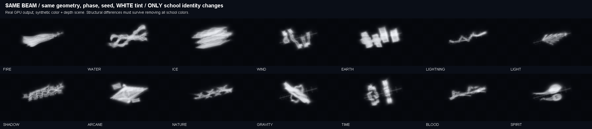

# 魔法可见性与学派区分修复

本批使用 Minecraft **26.3**、Java **26**，显示版本固定 **0.1.2**，内部构建 **0.7.0**。三模组客户端与服务端须一起更新；文件名沿用旧编号，应使用本批发行包并移走旧 JAR。管理员可在 `/tlb dev magic` 选择具体法术装入三个临时测试槽，主手持总魔典，默认 V 施法。

## 为什么之前完全不可见

Minecraft 26.3 RenderPearl 的 `RenderPass.draw` 参数顺序是 `vertexCount, instanceCount, firstVertex, firstInstance`。体积层与合成层曾调用 `draw(0, 3, 1, 0)`，实际提交 **0 个顶点**，编译成功也不会产生像素。现均改为 `draw(3, 1, 0, 0)`。

在同一实际 Minecraft 渲染夹具中，只回退这两处调用会让 HDR 和最终图像读回都为零；修复后有正常输出。混合因子经实际类核对是 ONE + ONE，保持原方案。之前裸 GLSL 测试没有经过 Java 绘制调用，无法发现这类错误，现已补上生产渲染器回归。

## 为什么之前很多效果相似

普通法术共用 20 类基础投放方式。同类法术曾大量共用行进图样与运动，学派差异常体现在颜色及命中后的附加状态；只比较配置指纹不足以证明玩家能看出不同。

本批为 14 学派加入独立主体结构：火舌、水带、晶锥、风刃、岩板、分叉闪电、光翼、影隙、符文棱体、藤蔓叶片、引力盘、时轮、血脉、魂焰。行进、命中和消散图样实际改变几何，20 类投放方式组合成不同轮廓。280 本普通法术重新配置显式轨迹与运动；同一投放类的跨学派检查现在有 9–12 种行进形状、6–8 种运动。

图为生产 GLSL 的 GPU 离屏输出，背景和深度为合成场景；不是玩家联机截图。去掉颜色后，1,820 组跨学派比较最低轮廓差 25.63%；2,660 组同学派投放方式比较最低 14.93%。这些指标检查指定画面的结构差异，不能替代游戏内不同机位与画质的辨识测试。

## 玩法差异与触发修复

55 条多目标命中规则原本把所有敌人共用的规则间隔作为冷却，同一 tick 的射线、扇形、连锁或冲撞通常只有首个敌人拿到附加效果。现对目标附加动作分别计时；自身回蓝与区域动作仍共享节流，整次施法的总次数不变，目标表最多 128 项。

14 种领域各加入三次有界区域脉冲。炎领域灼烧并冲击、潮领域浸湿并径向推离、霜领域冻结并缚足、岚领域挑空并径向推离、岩领域停止水平移动后下压；雷/辉/影/奥/森/引/时/血/灵也有各自的动作组合，详见[玩法说明](magic-system.md)与[完整目录](magic-catalogue.md)。固定落点效果从该落点推离敌人，目标资格和墙体遮挡继续检查。

这仍然是共享碰撞与生命周期、配合显式规则的 300 种法术，不等于 300 套独立底层算法。命中条件、阶段和区域效果的实际触发需要持续按游戏场景验收；目录或名字不重复本身不能证明机制完成。

## 本批证据

| 范围 | 结果 |
| --- | --- |
| 公共玩法与状态 | 77,655 项断言通过；含目标间隔、轨迹采样和领域脉冲周期 |
| 三端生产 RenderPearl | 每端 927 项检查、每端 300/300 法术有像素输出 |
| 生产 GLSL | 3,966 项断言通过，含同色轮廓、阶段图样、深度与生命周期 |
| Fabric 实际服务器 | 14,355 项断言；300 法术、14 种领域实体结果、0 魔法粒子包 |
| Paper 实际服务器 | 20,313 项断言；300 法术，本批生产 JAR |
| 旧绘制调用对照 | 同条件 HDR 和最终像素为零，断言按预期失败 |

实际服务器领域状态和最终发行包的检查记录见[魔法验证](magic-validation.md)。三端生产渲染夹具使用真实 Minecraft 类和 GPU，但使用合成场景；尚未替代完整玩家客户端中半透明实体、外部光影包与多人帧时间试玩。

可复跑的入口为 `scripts/test-magic-renderpearl.py`、`scripts/test-magic-shaders-gpu.py`、`scripts/audit-magic-distinctness.py --fail-on-suppression`。安装与配置见[安装说明](install-0.7.0.md)。
