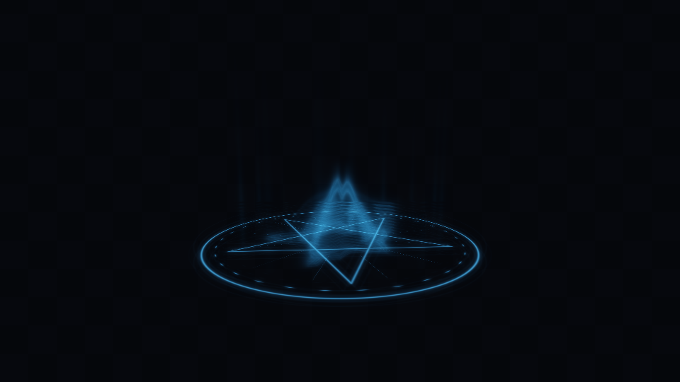
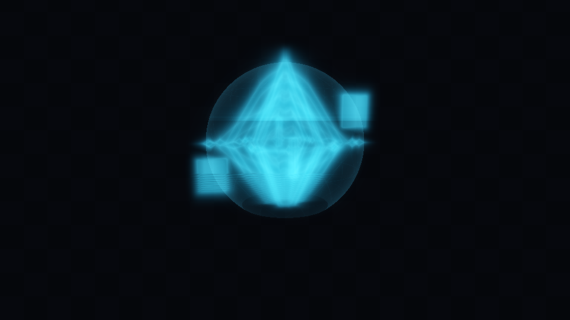
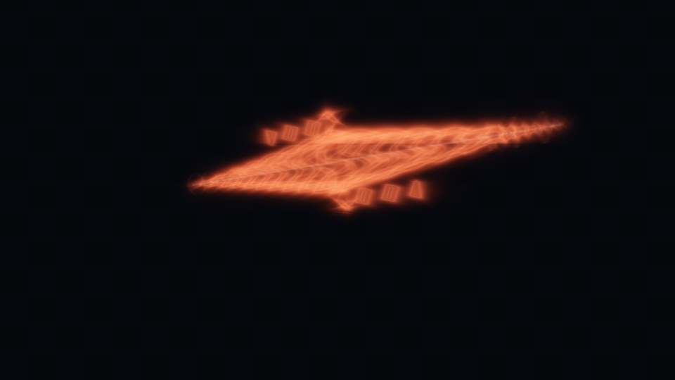
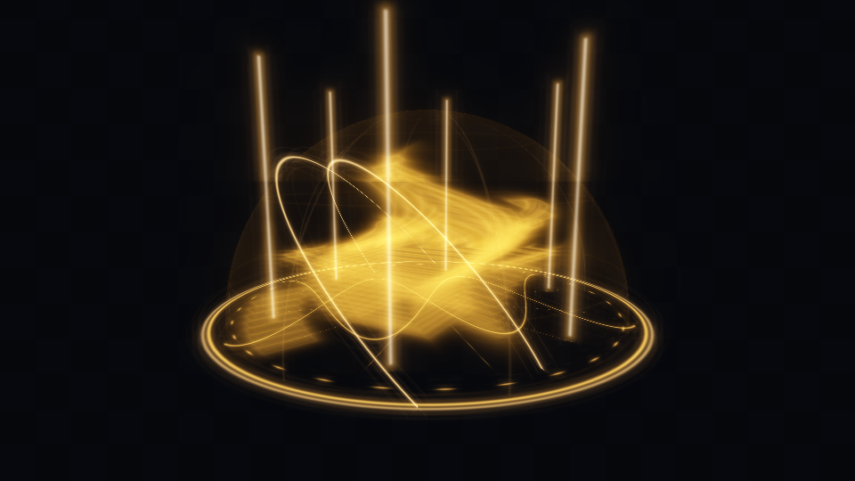
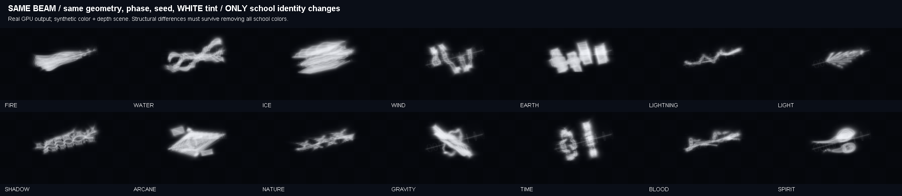
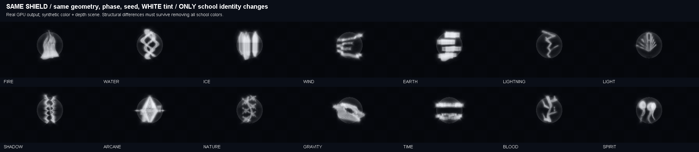
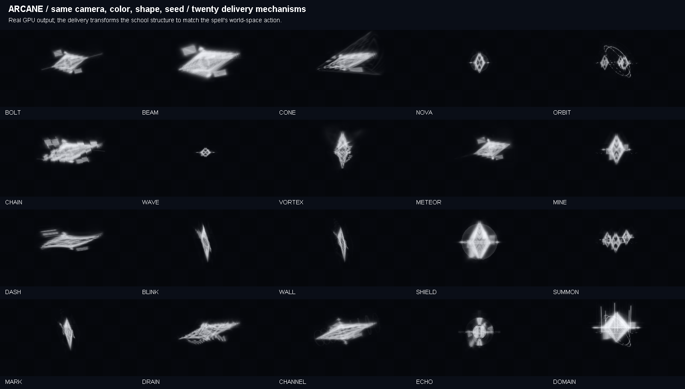

# 模组魔法视觉：世界空间着色器

2026-10-20 补充随身锚点的逐帧跟随：吟唱、环绕、护盾不再等待场景包更新位置，持续引导仅起点跟随眼位。第一/第三人称与远程玩家使用相应的原版渲染插值；固定世界效果保持落点。原因、回归和安装见[跟随修复记录](magic-follow-fix.md)。

Fabric、Forge、NeoForge 的魔法视觉改为独立的 GPU 着色器渲染。服务器发送法术、阶段、起终点、半径和生命期，客户端绘制连续法阵、光束、护盾、体积旋涡与超位领域；魔法渲染不创建 Minecraft 粒子。Paper 保留服务端可用的视觉方案。

## 使用与开发测试

管理员执行 `/tlb dev magic`，选择分类与具体法术，在详情中将其装入测试槽。也可以执行 `/tlb magic test <法术ID> [1–3]`。主手持总魔典，默认 V 施法、按住 G 选槽、左 Alt 加滚轮快速切换，均可在按键设置中更改。`/tlb magic teststop` 结束测试并恢复原学习、魔力和冷却记录，不需要把 300 本书装进背包。

魔法库的完整 ID 和机制见 [魔法玩法](magic-system.md)。查看吟唱、行进、命中、消散四阶段，以及高阶连续多阶段法术时，可以使用不同槽位重复对比。资源重载使用 F3+T；缺失或编译失败的自定义 shader 会输出诊断，并在资源重载后重新尝试。

## 原创渲染结构

参考本地 Shooting Star 模组学习了场景深度、镜头相对坐标和分阶段视觉的组织方式；本项目 Java、GLSL 和法阵图样独立编写，没有采用其 class、GLSL 或纹理。来源与差异记录在 [参考研究](shader-reference-research.md)。

1. 服务端只同步有限数量的场景意图，伤害、碰撞、学习和魔力仍由服务端判定；网络包不传粒子或逐顶点模型。
2. 客户端在世界渲染结束、第一人称手部渲染之前取得场景深度，使用本帧实际投影和相机旋转的逆矩阵重建世界射线。计算使用相机相对坐标，支持 reversed-Z 与两种 clip 深度范围。
3. 连续骨架使用解析几何：平面法阵与 12 种符号、护盾球面及干涉格、有限长光束与环形加速器、穹顶经纬、倾斜星仪环和冲击曲面。它们不会因为体积采样步数较低而变成断续点阵。
4. 柔和内部能量使用有界体积积分。20 种基础机制采用各自几何场，四阶段选择不同符号和运动；超位增加连续星环、穹顶或光柱结构。视觉不使用随机粒子点，也不使用随机屏幕采样抖动模拟主骨架。
5. 所有可见事件加到独立 `RGBA16F` 发光目标，再做一次带深度边界拒绝的多尺度合成。只对魔法发光取样，原版天空和雪地不成为 bloom 来源；主颜色目标只写入，不同时作为采样输入。

生产路径使用 Minecraft 26.3 的 **RenderPearl RenderPipeline / CommandEncoder**；没有在游戏渲染器中插入 raw OpenGL 调用。192-byte std140 `MagicFrame` 统一保存逆矩阵、目标尺寸、坐标、颜色、阶位、动画参数及独立学派结构标识。GPU 资源通过渲染线程管理，resize、资源重载、切世界和关闭时更新或释放；编译失败不会每帧反复重建。

## 预算

当前模组最多缓存 24 个场景，每帧绘制最多 8 个，通过距离、视锥和屏幕范围裁剪。发光目标与总绘制面积各有 **1,382,400 像素**上限；大场景占用预算后，其余场景可能跳过该帧。

通常使用 32 次体积采样，低帧率时降低为 24，低于 24 FPS 时降低为 16；只有屏幕包围范围不超过四分之一画面的小效果才使用 48 次。解析法阵、光束主轴和护盾轮廓不依赖这部分体积采样数。合成层采样数量固定，不随法术数量线性增加。

这些是视觉预算，不改变服务器技能命中和伤害。玩家仍需要在自己的显卡、窗口分辨率和同屏人数下验收帧时间。

## 真实 GPU 预览

以下图片来自生产 GLSL 在真实 GPU 上的离屏绘制，背景和地面深度为合成测试场景，**不是 Minecraft 实机截图**。没有执行参考 JAR，也没有使用粒子系统。

## 可见性修复与学派结构

2026-10-18 修复了三端完全看不到魔法的原因：Minecraft 26.3 RenderPearl 的 `draw` 参数为 `vertexCount, instanceCount, firstVertex, firstInstance`，旧调用实际提交零顶点。体积层和合成层现均提交 `draw(3, 1, 0, 0)`。同一实际 Minecraft 管线中回退这两处调用会再次读回零像素，恢复修复后有正常输出。`ADDITIVE` 的实际混合因子是 ONE + ONE，无需改变透明度。

此前裸 GLSL 离屏验证没有覆盖 Java 的绘制调用，因此没有发现这个问题。本轮新增直接运行三端生产 `MagicShaderRenderer.render` 的回归入口，覆盖实际 RenderPearl、资源加载、参数上传、深度复制及合成。

14 学派另外具有主体结构：火舌、水带、晶锥、风刃、岩板、分叉闪电、光翼、影隙、符文棱体、藤蔓叶片、引力盘、时轮、血脉与魂焰。主体结合飞矢、射线、扇形、护盾等投放方式，并使用行进、命中、消散的图样改变几何。280 种普通法术的轨迹与运动已按学派重新配置。

下图将颜色、机位、阶段和图样固定，只改变学派，检查效果是否有结构差异。它是生产 GLSL 的真实 GPU 离屏输出，使用合成背景和深度。

同一奥术学派的 20 种投放方式也分别检查轮廓：

## 验证结果与边界

环境：Minecraft 26.3 / Java 26，NVIDIA GeForce RTX 3050 Laptop GPU，OpenGL 3.3.0，驱动 616.92。

- `python scripts/test-magic-renderpearl.py`：三端生产渲染各 **927 项检查**通过，各 **300/300** 法术有最终像素输出。另检查真实视锥、全遮挡、过期与 TTL、清理、重载确定性、两千万格坐标稳定性及资源释放。
- `python scripts/test-magic-renderpearl.py --platform fabric --negative-control`：隔离副本恢复旧绘制调用，预期退出码 1，HDR 和最终颜色均为零。该失败证明回归能检出本次症状。
- `python scripts/test-magic-shaders-gpu.py --publish-previews`：生产 GLSL **3,966 项断言**通过。20 种机制的 1,820 组跨学派同色比较最低轮廓差 **25.63%**；14 学派内的 2,660 组机制比较最低 **14.93%**。另外比较 12 种图样、阶段、深度、生命周期和无效 shader 诊断。

轮廓差是测试图像的阈值掩码差异度，不是玩家辨识率。它能排除只换色的实现，不能证明所有镜头和画质设置下都容易识别。三端生产渲染测试使用真实 Minecraft 类与渲染器及合成场景，不是启动完整玩家客户端联机试玩。半透明世界顺序、外部光影包和多人帧时间仍需游戏内检查。

最新 GPU 日志为 `.tools/magic-identity-production-final/gpu-test.log`；三端实际管线日志为 `.tools/magic-renderpearl-production/{fabric,forge,neoforge}/render.log`，旧调用对照为 `negative-fabric/render.log`。真实管线护盾读回 HDR RGB 字节和为 **4,769,290**、最终颜色 RGB 和为 **1,552,219**；这些是像素校验量，不是亮度或帧率。

计时预热 5 帧、提交 20 帧、异步读取 GPU timer。8 个完全重叠的大型事件在 640×360、24 步下 p50 **11.947 ms**、p95 **12.079 ms**。这个压力场景未使用生产 scissor 和累计面积预算；不能换算为 Minecraft FPS，也不能与旧 shader 的计时混用。

当前生产资源 SHA-256：

| 资源 | SHA-256 |
| --- | --- |
| `magic_volume.vsh` | `a02711d18070f5cfd97a20c6e5f990625a4248a85c239312c6ebe9a130f0e3cd` |
| `magic_volume.fsh` | `e75b45b0969c94fbf5f4a797b55f4512846bbd67466448a3fa067c1883ba4ba7` |
| `magic_composite.vsh` | `6a075c228c24a218ab4e55962740e8b5f8d768b093708a5132b87b25b05da98a` |
| `magic_composite.fsh` | `c0cdb49f8b03d69a6fc966b7f151b9543bd9321a08547239101513b4bb3a8fe1` |
