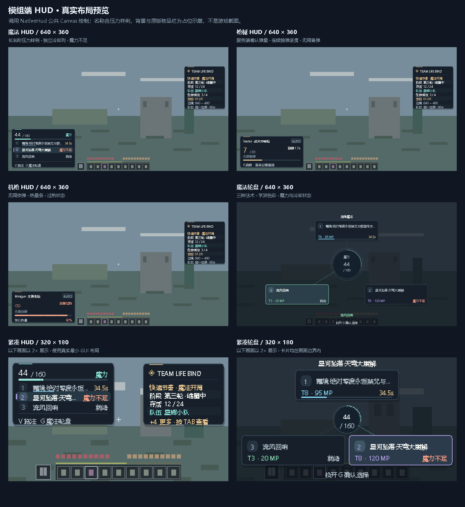

# 模组 HUD 视觉更新

**2026-11-15**：当前 HUD 使用共享 HTML/CSS。新增 F8 布局编辑器，可分别拖动和缩放十类组件；九格快捷栏固定居中，魔力与三个冷却槽在学会后常驻。详见[当前操作说明](archive-ui.md#hud-编辑与操作)。下方图片和原生绘制记录属于早期版本。

2026-11-13 后续批次已更新为共享 HTML/CSS 布局，见[当前实机预览与覆盖范围](archive-ui.md)。本页保留此前布局与数据模型的记录。

**2026-11-02**：本页预览已更新为最新配色与布局；大厅、开发目录、魔法目录和 RG 等全部项目菜单也已统一，详见[完整界面更新](client-ui.md)。

适用于 Fabric、Forge、NeoForge，Minecraft **26.3 / Java 26**，游戏显示版本仍为 **0.1.2**。三个模组共用同一套布局与颜色，使用原生 GUI 绘制，不需要额外材质包或光影。

图片直接调用生产 `NativeHud` 布局导出，背景与原版热键栏是示意占位，**不是游戏截图**。

## 显示内容

| 区域 | 视觉与信息 |
| --- | --- |
| 魔法卡片 | 大号当前魔力、薄荷青分段条、三槽序号、选中槽底色、独立冷却列、缺魔提示与吟唱进度 |
| 枪械卡片 | 大号确认弹量、弹匣上限、无限备弹、实际换弹剩余与进度；Minigun 单独显示热量和过热 |
| 魔法轮盘 | 中央魔力环、槽位连线、三张学派色卡片、独立选中法术名、阶位、消耗与冷却状态 |
| 对局侧栏 | 暖金标题、半透明底板和交替行；复用服务端原有顺序、文字与状态颜色，隐藏装饰性的排序分数 |

普通屏幕将战斗卡片放在热键栏左侧，小窗口则上移并缩紧魔法行距。姓名和法术名称按当前客户端字体宽度截断，冷却保留独立区域。侧栏只替换 `tlb_sidebar`，其他记分板按原版绘制。

空间不足时，侧栏保持正常字号并折叠尾部，以 `+数量` 和实际玩家列表键提示更多信息；**按住玩家列表键（默认 Tab）展开**，松开恢复紧凑显示。临时展开期间优先显示完整对局列表。魔法轮盘的三个卡片在最小常见 `320×180` GUI 坐标中也处于画面内。

## 操作与可见性

默认 **V 施法、G 轮盘、Alt + 滚轮切槽，R 换弹**。所有提示读取当前绑定，修改按键后立即反映；轮盘松开只选槽，键盘操作即时响应。按 F1 隐藏常驻 HUD；背包、聊天、轮盘等界面或加载遮罩打开时隐藏战斗卡片和侧栏。死亡与旁观隐藏战斗卡片，旁观仍可查看正常对局侧栏。

持总魔典时显示魔法卡片，包括尚未学习时的指引；持有效签发枪械时显示枪械卡片。枪械首次服务器确认前显示等待状态，不把物品上的旧弹量当作确认数值。装填进度只在服务端更新的基础上递减，后续心跳不会把进度重新归零；机枪热量来自服务器，不在 HUD 中模拟伤害或扣弹。

模组移除每半秒一次的常驻枪械行动栏与对局侧栏枪械重复行，治疗、空投争夺、侦察与错误提示继续使用原交互渠道。此批次需同时替换模组服务端与玩家客户端 JAR；Paper 不应用这套 HUD，安装文件见[安装说明](install-0.7.0.md)。

## 实现与检查

- `common/NativeHud` 负责布局、颜色、进度条和按像素截断；三端 `NativeHudCanvas` 使用 Minecraft 26.3 `GuiGraphicsExtractor`，所有坐标采用缩放后的 GUI 坐标。
- 三端 `GunClientPresentation.HudState` 只读服务端确认；`NativeSidebarHud` 复用既有记分板，每游戏 tick 检查变化，内容未变时复用转译结果。
- 三端 Java 26 编译通过。`scripts/ExportNativeHud.java` 通过生产布局导出魔法、换弹、热量、轮盘和紧凑布局，检查坐标边界、文本重叠及多种窗口的轮盘边界。
- 最新预览检查通过：2,729 个矩形、107 次文字绘制、915 对文字相交比较、20 项热键栏/副手槽保护区检查；窗口覆盖 `320×180` 至 `1280×720`。背景示意不代表游戏实机观感。
- 真实 Minecraft 26.3 记分板探针三端共通过 **87 项断言**，检查排序、继承颜色、隐藏项、15 行上限、缓存及语言失效，并验证其他目标不被拦截和 Mixin 注入签名。本地记录为 `.tools/native-hud-sidebar-probe/probe.log`。
- 枪械只读 HUD 状态探针共通过 **126 项断言**，覆盖确认弹量、换弹心跳与逐颗装填、过热锁存、旧序号拒绝、身份切换清理和菜单保留。Fabric / Forge 使用各自实际 MC 类库；NeoForge 生产类使用 vanilla 26.3 API 运行夹具，未把它计作完整 NeoForge 客户端运行。记录为 `.tools/native-hud-state-probe/probe.log`。
- 最新三个模组的隔离服务端均正常启动并退出，项目/Mixin 错误扫描为 0；公共回归通过 1,430,685 项断言，Fabric 玩法回归通过 1,073 项断言。Paper 生产 JAR 与资源包的校验值保持上一 RG 批次一致。

这些检查覆盖代码、布局预览和本地 API 接入；实际 Minecraft 客户端的材质包字体、各种 GUI 缩放和多人战斗观感仍需实机试玩。
