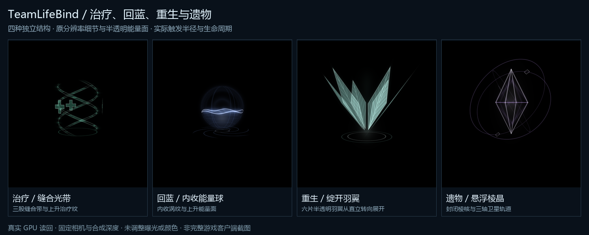
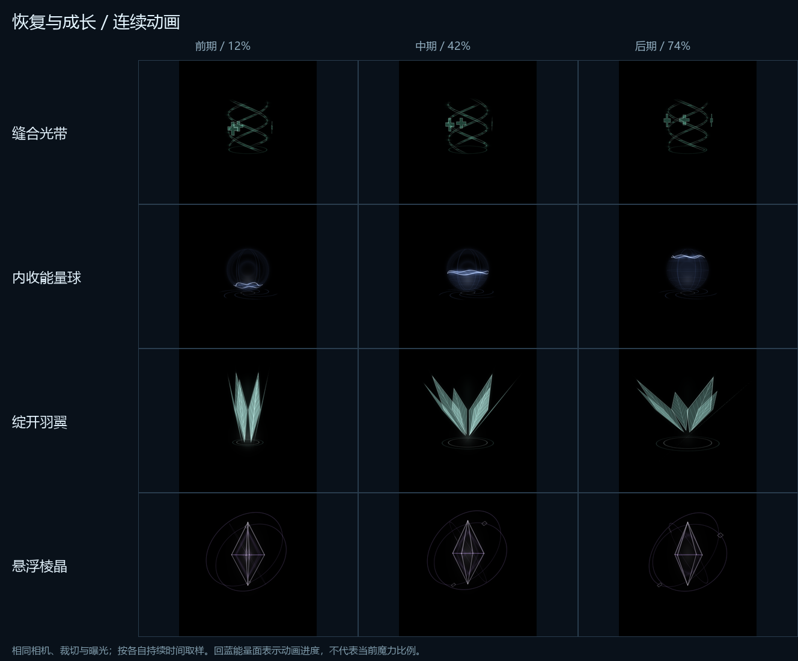

# 治疗、回蓝、重生与遗物特效 — 2026-11-05

Fabric、Forge、NeoForge 的四类恢复／奖励事件使用各自的几何结构和连续动画。显示版本 **0.1.2**，构建 **0.7.0**，Minecraft **26.3**，Java **26**。



| 事件 | 新画面 | 触发 |
| --- | --- | --- |
| 治疗 | 三股缝合光带、横向缝线、上升治疗纹 | 绷带实际恢复生命后 |
| 回蓝 | 内收涡纹、球形能量壳、逐渐上升的能量面 | 魔力药水实际恢复魔力后 |
| 重生 | 六片半透明羽翼从直立逐渐向外展开 | 队伍床重生完成后 |
| 遗物 | 封闭八面棱晶、三条不同倾角的卫星轨道 | RG 路线选定并应用遗物后 |

治疗和回蓝仍持续 28 tick，重生和遗物 36 tick；原有消耗、恢复量、伤害和奖励规则保留。回蓝球的能量面表示特效动画进度，实际魔力仍以 HUD 为准。



新增结构在已有原分辨率细节层绘制，半透明表面进入体积层。曲面读取世界深度，内部视角保留远侧表面；边界裁切消除掠射角产生的远处细线。保持现有绘制预算，使用着色器而非 Minecraft 粒子。

## 验证

- 三模组各 **331 项**专项 GPU 检查：四类细节与禁用控制比较、六组相同半径／位置／白色轮廓比较、12 帧动画、四种内部视角与部分深度遮挡，以及重载、清理和边界检查。
- 每端 **24 帧**稀疏事件包跟随检查，四种效果在 0.25／0.75 tick 的玩家位置与参考画面逐像素一致。
- 三模组各 **530 项**世界效果检查，覆盖全部 24 类世界事件；各 **3,517 项**攻击回归，覆盖 300 种法术、347 个机制阶段、694 组吟唱／攻击组合。
- Fabric 另在 **2560×1440** 下执行专项检查。发行类和着色器哈希与生产 GPU 记录绑定。

图片来自真实 RenderPearl GPU 读回，使用固定相机和合成深度，裁切方式一致，未改曝光或颜色。它们不是完整游戏客户端截图，未作为多人帧率或外部光影兼容的实机结论。

## 安装

已安装“成长与远征”或“武器、补给与首领”批次时，只需替换**玩家客户端对应加载器的模组并重启**；单人／本地开房替换自己的模组。更早批次请同时更新模组服务端，以获得此前的事件同步。

无需额外光影包。Paper 插件与资源包保持上一批文件。文件名沿用，请以本批 ZIP／SHA-256 区分。

```text
python scripts/test-magic-renderpearl.py --built-renderer --restoration-details --output .tools/vfx-restoration-final-details
python scripts/test-magic-renderpearl.py --built-renderer --world-effects --output .tools/vfx-restoration-final-world
python scripts/test-magic-renderpearl.py --built-renderer --attack-stages --output .tools/vfx-restoration-final-attack
python scripts/test-magic-renderpearl.py --built-renderer --restoration-details --platform fabric --width 2560 --height 1440 --output .tools/vfx-restoration-final-1440p
python scripts/render-restoration-vfx-preview.py
```
