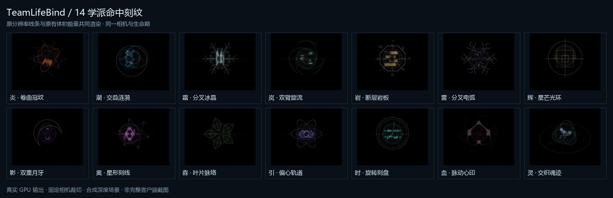
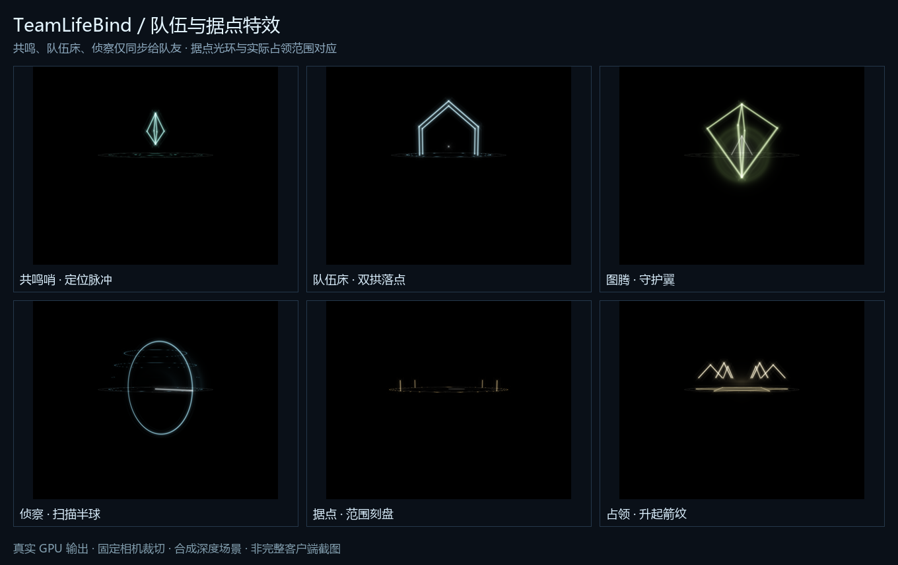

# 学派命中与队伍特效 — 2026-11-04

本批继续扩展 Fabric、Forge、NeoForge 的着色器表现。世界特效从 12 类增加到 **18 类**，魔法命中与持续区域增加 **14 套学派刻纹**。全部使用连续几何和 GPU 线条，显示版本 **0.1.2**、Minecraft **26.3**、**Java 26**。

## 魔法辨识

| 学派 | 新增高清纹样 |
| --- | --- |
| 炎／潮 | 卷曲火焰冠纹／错位涟漪与交叠水流 |
| 霜／岚 | 六向分叉冰晶／双臂对数旋流 |
| 岩／雷 | 八向断层岩板／带分支的折线电弧 |
| 辉／影 | 星芒与菱形光环／相对旋转的月牙 |
| 奥／森 | 交叉三角星纹／带叶脉的五叶图案 |
| 引／时 | 三组偏心轨道／刻度盘与两根独立转动的指针 |
| 血／灵 | 脉动心印／三股交织魂迹 |

命中时刻纹随冲击扩张并消散；波浪、旋涡、地雷、墙体、护盾、召唤、印记、回响和领域的持续阶段也会绘制对应学派图案。原有每个法术的机制、颜色、阶位和体积骨架继续参与合成。本批增加的是学派细节，不将 300 个法术改成同一个命中模板。

## 队伍与据点

| 效果 | 触发 | 可见范围 |
| --- | --- | --- |
| 共鸣定位 | 共鸣哨成功标记后出现扩散脉冲与悬浮菱形 | 同维度附近的存活队友 |
| 队伍床落点 | 队伍床放置确认并登记成功后展开双拱 | 同维度附近的存活队友 |
| 图腾守护 | 队伍图腾成功抵消致死伤害后展开晶体守护翼 | 附近玩家 |
| 侦察扫描 | 侦察道具成功消耗后出现扫描半球 | 同维度附近的存活队友 |
| 据点范围 | 启用据点规则时，以持续光环标出 6 格占领半径 | 附近玩家 |
| 占领完成 | 据点实际发放占领奖励时升起箭纹 | 附近玩家 |

标记、床和侦察不会把队伍位置发送给敌人或未参赛旁观者。冷却失败和未完成操作不会产生成功特效。侦察扫描仅表现道具启动，敌人位置仍按原侦察规则判定；据点光环替换原来的末地烛粒子。

## 同步与预算

新增 `teamlifebind:world_vfx_v2` 可选通道，避免旧客户端收到未知特效类型。旧通道客户端不会收到新版世界事件；双方更新后获得完整表现。魔法同步协议保持原格式，客户端资源重载可重新加载细节着色器。

空投和据点沿用稳定事件 ID，刷新时保持动画相位；不再刷新后自动过期。沿用每维度每 tick 96 个视觉事件上限、魔法／世界各 24 个缓存、每帧 8／4／2 个效果上限，以及体积层 1,382,400 像素和细节层两个屏幕的覆盖预算。服务端伤害、物品和奖励规则不因视觉预算变化。

## 验证与安装

- 三端生产管线检查 18 类效果的显示、动画、遮挡、过期与持续刷新，各 **251 项**通过。
- 14 学派的命中与领域先移除体积层、统一白色，再做 **182 组**轮廓比较；还验证完整合成、遮挡和动画，各端 **519 项**检查通过。该指标用于发现形状重复，不等同于玩家辨识率。
- 全部 300 种魔法及超位连段继续检查吟唱和攻击共存，覆盖 347 个机制阶段、694 组组合，各端 **3,517 项**检查通过；逐帧跟随各端 **1,213 项**检查通过，42 组运动／视角的对齐读回无像素差。
- 隔离服务端使用实际控制器验证新交互、冷却失败、队伍接收范围、一次性奖励和旧通道过滤，连同 SUR／PVE／PVP／RG 回归共 **1,143 项**断言通过。Forge、NeoForge 独立服务端启动检查通过。完整玩家客户端、多人帧时间及外部光影兼容仍需实机验收。

预览取自真实生产 GPU 输出，使用固定裁切与合成相机／深度；没有修改亮度或绘制额外效果，**不是完整 Minecraft 游戏截图**。可运行 `scripts/test-magic-renderpearl.py --built-renderer --world-effects` 或 `--school-details` 复查。

请一起更新 **客户端与模组服务端**；单人／本地开房替换自己的模组并重启。无需额外光影包。Paper 插件和资源包与 11 月 3 日批次相同，安装见[指南](install-0.7.0.md)。
