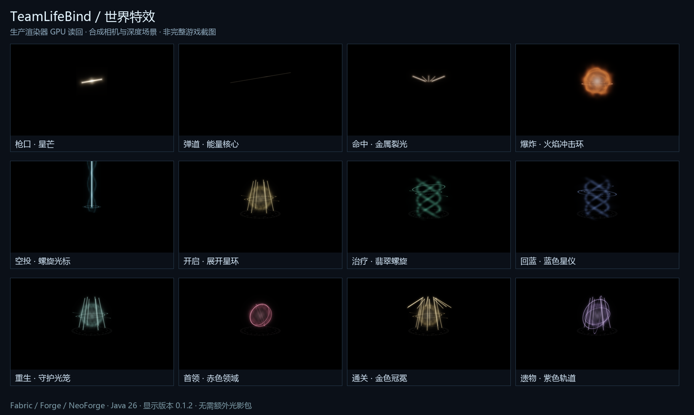

# 高清魔法与世界特效 — 2026-11-03

2026-11-04 已扩展为 18 类世界特效，并增加 14 套学派命中与领域刻纹，最新说明见[后续更新](vfx-plus.md)。以下为首批实现记录。

Fabric、Forge、NeoForge 增加 12 类连续几何特效，覆盖枪械、空投、恢复、首领和通关。全部魔法增加原始窗口分辨率的细节层：符文刻线、光束核心、护盾网格和命中裂光与原有体积能量共同渲染。显示版本仍为 **0.1.2**，使用 Minecraft **26.3 / Java 26**，无需额外光影包。

## 实际触发

| 场景 | 触发与画面 |
| --- | --- |
| 枪口 | 七把模组枪械成功发射时出现短促星芒 |
| 弹道 | 子弹射线与飞行火箭显示连续发光核心；霰弹只显示前三条，避免堆满画面 |
| 命中 | 子弹击中实体或方块时出现放射裂光 |
| 爆炸 | 火箭爆炸显示膨胀火焰体积与冲击环 |
| 空投定位 | 锁定空投显示 18 格高的螺旋光柱，每秒刷新同一个效果 |
| 空投开启 | 成功完成认领并填充物资后展开星环 |
| 治疗 | 绷带成功恢复生命后出现绿色螺旋 |
| 回蓝与成长 | 成功消耗回蓝药水、强效药水或魔力苹果后出现蓝色星仪 |
| 重生 | 比赛的待重生流程完成后出现保护光笼；不是 SUR 普通死亡重生的通用提示 |
| 首领 | PVE／RG 首领成功生成时展开赤色领域 |
| 通关 | 完成关卡挑战并进入最终结算展示时，参赛者出现一次金色冠冕 |
| 学习与遗物 | 成功学习魔法书或应用 RG 路线奖励后出现紫色环轨 |

这些事件只表现已发生的玩法结果，不改变伤害、命中、奖励、冷却和物品消耗。魔法和新增世界效果使用 GPU 着色器，不创建原版粒子；枪械原有的 CRIT／爆炸粒子表现已替换。

## 清晰度与预算

体积能量经过 HDR 合成；符文、光束和网格另在原始窗口分辨率绘制，使用导数抗锯齿。即使体积层因同屏效果降采样，细线仍能保持清晰。两层均读取世界深度，不穿透实体方块。魔法保留学派、机制、阶段与阶位差异；新细节不替代原有独立机制。

魔法和世界事件各缓存最多 24 个，合计每帧最多绘制 8 个；低于 40／24 FPS 时降为 4／2 个。体积层共享 **1,382,400 像素**预算，原分辨率细节层累计覆盖最多两个屏幕。服务器每维度每 tick 最多广播 96 个世界视觉事件，仅发送给附近且支持该可选通道的玩家。空投刷新沿用稳定 ID 与动画相位，避免反复叠加光柱；切世界、重载和过期时清理。

## 预览与验证

下图来自生产 Java 渲染器和 GLSL 的真实 GPU 读回。相机、背景和深度为测试场景，**不是完整 Minecraft 客户端游玩截图**。

- 三种加载器分别通过 12 类世界效果的 **175 项**检查，包括可见性、动画、遮挡、过期、刷新、重载以及 100／192 格弹道端点；原分辨率细节层单独验证了实际像素贡献。
- 全部 **300 种**魔法、**347 个**机制阶段、**694 组**吟唱与攻击组合，三端分别通过 **3,517 项**检查。跟随回归三端分别通过 **1,213 项**检查，42 组运动／视角读回无延迟像素差。
- 使用真实服务端控制器测试七把枪的枪口、弹道及命中／爆炸，**194 项**断言通过；SUR、PVE、RG 流程及新视觉事件共 **1,112 项**断言通过，包括绷带治疗、空投认领、首领、通关和奖励。网络编解码、非法坐标与不支持新通道的客户端也纳入检查。
- 当前测试覆盖生产管线与隔离服务端。多人同屏帧时间、外部光影兼容及完整客户端操作体验仍需实机验收。

可复跑：`python scripts/test-magic-renderpearl.py --built-renderer --world-effects --width 2560 --height 1440`，以及 `--attack-stages` 和默认跟随回归；玩法检查使用 `python scripts/test-play-modes.py`。

## 安装

替换本批对应加载器的 **客户端和模组服务端 JAR** 并重启；单人／本地开房替换自己的模组即可。仅升级客户端连接旧模组服务端时，魔法细节层可用，但不会收到新增世界事件。Paper 插件保持原内容；其资源包移除不会由原版客户端加载的模组专用着色器，实际物品显示不变。已安装旧资源包可继续使用，新部署使用本批安装指南中的 SHA-1。

本批文件名与显示版本继续沿用，请用发行 ZIP 及 SHA-256 区分批次。详情见[安装指南](install-0.7.0.md)。
